# Ultimate CS2 RCON and Server Management Tool - macOS Guide

Version: 1.0.6

This self-contained guide covers the macOS application packages and Remote Linux or Remote Windows server management. Valve does not publish a native macOS CS2 dedicated-server runtime, so macOS cannot use Local Linux or Local Windows profiles.

[README.md](README.md) provides the project-wide GitHub overview. This file contains all instructions needed for the macOS package.

Download `cs2-rcon-tool-universal-v1.0.6-macos-x64.tar.gz` (Intel) or `cs2-rcon-tool-universal-v1.0.6-macos-arm64.tar.gz` (Apple Silicon) from [GitHub Releases](https://github.com/ShAgGy2035/Ultimate-RCON-Server-Tool/releases/tag/v1.0.6).

## Table of Contents

- [Requirements](#requirements)
- [Install And Launch](#install-and-launch)
- [Update The Application](#update-the-application)
- [Create A Remote Profile](#create-a-remote-profile)
- [Choose A Lifecycle Mode](#choose-a-lifecycle-mode)
- [Remote Linux Setup](#remote-linux-setup)
- [Remote Windows Setup](#remote-windows-setup)
- [Frameworks, Plugins, And Backups](#frameworks-plugins-and-backups)
- [RCON Tool Companion And Fun Stuff](#rcon-tool-companion-and-fun-stuff)
- [PlayerPunishments](#playerpunishments)
- [ChatRelay](#chatrelay)
- [Using The Application](#using-the-application)
- [macOS Integration](#macos-integration)
- [Troubleshooting](#troubleshooting)
- [Issues](#issues)
- [About](#about)
- [Application Screenshots](#application-screenshots)

## Requirements

- macOS 12.0 or later.
- The x64 package for an Intel Mac or the arm64 package for Apple Silicon.
- Network access to the configured SSH or hosting-panel endpoint. The game RCON port need not be exposed when using a tunnel or panel console.
- SSH access for remote lifecycle/installation operations, or a compatible Linux hosting panel for power and console access. File operations need SFTP access and a verified server fingerprint.

## Install And Launch

Extract the matching package and open `CS2 RCON Tool.app`.

The packages are self-contained and do not require a separate .NET installation. They are currently unsigned and not notarized. Only if you trust the downloaded package and Gatekeeper quarantines it, open Terminal in the extracted directory and run:

```bash
xattr -dr com.apple.quarantine "CS2 RCON Tool.app"
chmod +x "CS2 RCON Tool.app/Contents/MacOS/cs2-rcon-tool"
open "CS2 RCON Tool.app"
```

## Update The Application

Close the application, extract the new package, and replace the entire `CS2 RCON Tool.app` bundle. Do not merge files inside the old bundle.

Writable settings are typically stored under:

```text
~/Library/Application Support/CS2RconTool
```

Back up that entire directory, including `credential.key`, before updating. Saved secrets use AES-256-GCM, so keep the key with the profile and settings JSON files during migration.

## Create A Remote Profile

Before testing a connection, configure a [protected connection and verified server fingerprint](#remote-rcon-transport-and-host-pins). A hosting-panel console does not need SSH credentials, but file access still needs verified SFTP.

1. Open **Servers > Manage servers**.
2. Add either **Remote Linux (SSH)** or **Remote Windows (SSH)** according to the target server's operating system.
3. Enter the SSH host, port, username, and password.
4. Enter optional separate SFTP details, or leave them blank to reuse the SSH connection.
5. Choose **Direct process** or **Service commands**.
6. Complete the lifecycle and SteamCMD settings described in the matching target-server guide.
7. Enter the server address, game/RCON port, and RCON password.
8. Save the profile and select it in the main server list.

Imported Local Linux or Local Windows profiles may be displayed, but local lifecycle and installation actions cannot run on macOS. Convert them to the correct Remote profile type and replace local paths with paths valid on the target server.

## Choose A Lifecycle Mode

### Direct Process

Choose Direct process when the application should start and stop the remote CS2 executable over SSH.

- Remote Linux setup: [Remote Linux Direct Process](#remote-linux-direct-process)
- Remote Windows setup: [Remote Windows Direct Process](#remote-windows-direct-process)

The application supplies the selected tickrate, VAC state, and LAN mode for Direct-process launches. Direct mode does not provide automatic startup at target-system boot or automatic restart after a crash. macOS manages remote servers only, so **Start server without validation** is not a local macOS launch option; normal remote Start runs SteamCMD validation when the profile has the required SteamCMD and install-directory settings, while Restart skips validation.

### Service Commands

Choose Service commands when systemd or a Windows service wrapper already owns CS2.

- Remote Linux systemd setup: [Remote Linux Service Commands With systemd](#remote-linux-service-commands-with-systemd)
- Remote Windows WinSW setup: [Remote Windows Service Commands With WinSW](#remote-windows-service-commands-with-winsw)

The application executes configured Start, Stop, and Restart commands; it does not install the service. Put CS2 launch settings such as `-tickrate`, `+sv_lan`, and `-secure` or `-insecure` in the target service configuration.

Stop the current owner before switching lifecycle modes. Direct process and Service commands must not manage the same executable and port simultaneously.

Normal remote **Start server** runs SteamCMD validation before startup when the profile has the required SteamCMD and install-directory settings. **Validate server files** can validate the remote installation without starting CS2, while **Install/Update Server** updates, repairs, and validates it. **Restart server** skips validation.

## Remote Linux Setup

Configure SSH host, port, username, password, optional SFTP details, SteamCMD path, install directory, App ID `730`, and login, normally `anonymous`. Blank SFTP values reuse SSH details; port `0` reuses the SSH port, and valid ports range through `65535`. The account must run lifecycle commands and read/write the installation.

### Remote Linux Hosting Panel

For a hosting provider that exposes a Pterodactyl-compatible panel but does not provide SSH, use **Hosting panel API** for the Remote Linux lifecycle mode. Enter the HTTPS panel URL, server identifier/UUID, and a client API key with power and console permissions. Console commands and lifecycle actions use the panel's short-lived-token WSS console/API; normal certificate validation is retained and redirects are rejected. The game RCON password is optional and never sent to the panel. Keep SFTP credentials and their independently verified host pins for file operations. SteamCMD validation and remote shell operations are unavailable. Debug Mode excludes API keys, JWTs, and configured endpoints. Console output is bounded and marker-delimited with a short window for asynchronous replies; unrelated logs may interleave and later output may be missed because the protocol does not correlate command replies.

### Remote RCON Transport And Host Pins

Remote RCON is blocked unless one of these is configured, listed from most to least secure:

1. **Verified SSH tunnel (recommended).** In **Edit server > Transport security**, tick **Enable verified SSH tunnel**, save the SSH username and password, and enter the pin host, port, and fingerprint below. RCON is then sent through the tunnel to the server's own `127.0.0.1`.
2. **Hosting panel console** (Remote Linux, Hosting panel API). The panel's shared console can drop lines and echo `rct_..._begin/_end` markers, so the player table may occasionally miss rows; Universal reuses the last complete roster to compensate.
3. **Unencrypted direct RCON (explicit exception).** Tick **Allow UNENCRYPTED direct RCON to this remote server** only when the provider offers neither SSH nor a reliable console. The RCON password and every command then cross the network in clear text. It is off by default, applies per server, requires the RCON TCP port to be reachable and the RCON password saved in the profile, and is never enabled automatically. Use a unique RCON password and restrict the port to your address where the provider allows it. Use this exception only if you accept that exposure.

**Getting the host fingerprint.** The pin is the SHA256 of the server's SSH host key as `SHA256:` followed by 43 unpadded base64 characters, the same format `ssh-keygen -lf` prints. Read it on the server itself or from the provider's trusted console, never from the connection you are about to trust:

- Linux: `ssh-keygen -lf /etc/ssh/ssh_host_ed25519_key.pub`
- Windows (OpenSSH): `ssh-keygen -lf C:\ProgramData\ssh\ssh_host_ed25519_key.pub`

Enter the exact host and port the profile connects to, plus the fingerprint, in the SSH pin fields. A different key type, host, or port needs its own explicit pin. A mismatch is refused without fallback.

**Symptom: players appear as "Bot 1", "Bot 2".** The app could not run RCON `status` and fell back to the A2S query, which has no names. Check that the profile uses one of the transports above (for a lab or remote server on a private address, normally the verified SSH tunnel) and that the SSH password and pin are saved.

### Remote Linux Account And Permissions

Prepare the remote accounts before configuring the macOS profile. The **SSH control account** is the username entered in the profile; it runs lifecycle commands and performs SFTP browsing, file transfers, plugin operations, backups, and SteamCMD operations. The **service account** owns and runs CS2 when using Service commands with systemd. These can be the same account, or they can be separate accounts.

The simplest setup uses the Linux account that owns the CS2 installation for both SSH and SFTP. If a dedicated SSH account does not already exist, create it as an administrator on the remote host and grant it SSH access:

```bash
sudo adduser <ssh-user>
sudo passwd <ssh-user>
```

Do not use `root` as the application, SteamCMD, or CS2 account. The SSH control account must be able to traverse every parent directory and read and write the CS2 installation. If it differs from the service account, grant access through a shared group or filesystem ACL rather than making the installation world-writable.

If the systemd service account does not already exist, create it before installing or assigning ownership of the CS2 files. It may be the same account as `<ssh-user>`:

```bash
sudo adduser <service-user>
```

Verify access before saving the macOS profile. Replace the placeholders with the configured account and install directory:

```bash
namei -l "<install-dir>/game/csgo"
sudo -u <ssh-user> test -r "<install-dir>/game/csgo/gameinfo.gi"
sudo -u <ssh-user> touch "<install-dir>/game/csgo/.rcon-tool-write-test"
sudo -u <ssh-user> rm "<install-dir>/game/csgo/.rcon-tool-write-test"
```

Prefer a shared group or ACL instead of world-writable permissions:

```bash
sudo setfacl -m u:<ssh-user>:x "<parent-directory>"
sudo setfacl -R -m u:<ssh-user>:rwX "<install-dir>"
sudo setfacl -R -d -m u:<ssh-user>:rwX "<install-dir>"
```


### Remote Linux Direct Process

For `/home/cs2/cs2server`, blank fields derive:

```text
Executable:        /home/cs2/cs2server/game/bin/linuxsteamrt64/cs2
Working directory: /home/cs2/cs2server/game (But not required)
```

Set map, game type, game mode, and optional additional arguments. The application supplies `-dedicated`, `-console`, port, hostname, map, CFG, RCON password, tickrate, LAN mode, and VAC state. The default `-ip 0.0.0.0` binds CS2 to all available network addresses; replace `0.0.0.0` with a specific address in the launch arguments when direct interface binding is required. Use a path-specific Stop command:

```bash
executable='/home/cs2/cs2server/game/bin/linuxsteamrt64/cs2'; for process in /proc/[0-9]*; do target=$(readlink "$process/exe" 2>/dev/null || true); if [ "$target" = "$executable" ]; then kill -TERM "${process##*/}"; fi; done
```

Start refuses to run during an app `730` SteamCMD update, verifies `game/csgo/gameinfo.gi`, supplies required native-library paths, launches detached from SSH, and monitors for 30 seconds. Output is captured in `/tmp/cs2-rcon-tool-startup-<port>.log`. Direct mode refuses to control an executable owned by the active `cs2-server` systemd cgroup.


### Remote Linux Service Commands With systemd

The application controls an existing service; it does not create privileged unit or sudoers files. Create `/usr/local/libexec/cs2-rcon-tool-start` after replacing placeholders:

```bash
#!/usr/bin/env bash
export HOME="<service-home>"
export LD_LIBRARY_PATH="<install-dir>/game/bin/linuxsteamrt64:<install-dir>/game/csgo/bin/linuxsteamrt64:<install-dir>/.steam/sdk64:<install-dir>/steamcmd/linux64${LD_LIBRARY_PATH:+:$LD_LIBRARY_PATH}"
cd "<install-dir>/game"
"<install-dir>/game/bin/linuxsteamrt64/cs2" \
	-dedicated -ip 0.0.0.0 -high -nobreakpad -nomemorystats -nojoy \
	+sv_hibernate_when_empty 0 +map de_dust2 +game_type 0 +game_mode 1 \
	+exec server.cfg -console -port 27015 -tickrate 64 -secure +sv_lan 0 \
	+hostname "CS2 Server" -usercon +rcon_password "<rcon-password>" &
child=$!
shutdown() { kill -TERM "$child" 2>/dev/null || true; wait "$child" 2>/dev/null || true; exit 0; }
trap shutdown TERM INT
wait "$child"
exit $?
```

Create `cs2-server.service`:

```ini
[Unit]
Description=Counter-Strike 2 Dedicated Server
After=network-online.target
Wants=network-online.target
StartLimitIntervalSec=300
StartLimitBurst=5

[Service]
Type=simple
User=<service-user>
Group=<service-group>
ExecStart=/usr/local/libexec/cs2-rcon-tool-start
Restart=on-failure
RestartSec=5
TimeoutStopSec=30
KillSignal=SIGTERM
KillMode=mixed

[Install]
WantedBy=multi-user.target
```

Grant the SSH account only the required lifecycle commands:

```sudoers
<ssh-user> ALL=(root) NOPASSWD: /usr/bin/systemctl start cs2-server, /usr/bin/systemctl stop cs2-server, /usr/bin/systemctl restart cs2-server, /usr/bin/systemctl status cs2-server, /usr/bin/systemctl is-active cs2-server
```

Configure the profile:

```text
Startup mode: Service commands
Start:   sudo -n systemctl start cs2-server
Stop:    sudo -n systemctl stop cs2-server
Restart: sudo -n systemctl restart cs2-server
Remote install directory: <install-dir>
```

All CS2 arguments belong in the launcher; the default `-ip 0.0.0.0` binds to all available network addresses and can be replaced with a specific address. Start validates when SteamCMD and the install directory are configured, then requires the service-owned process to remain alive for 30 seconds. Restart skips validation. Stop verifies that it exits.


### Finish Remote Linux Setup

After the Remote Linux profile and its Direct process or Service commands setup are complete:

1. Save the server profile.
2. Select the server in the top server list.
3. Right-click the server and select **Install/Update server...** to install or validate CS2 with SteamCMD.
4. If you also need the supported frameworks and tracked plugins maintained, select **Install/Update Server + Add-ons** instead.
5. Confirm the remote Linux firewall allows the configured game port over UDP and RCON port over TCP.
6. Wait for the operation to finish and review **Console Commands**, **Application Log**, or **Debug**, then right-click the server again and select **Start server**.

If you selected **Install/Update server...** without add-ons, install the frameworks first:

1. Right-click the running server and select **Install/Upgrade Metamod**. Choose a compatible release or paste the direct package URL, then wait for installation to finish.
2. Right-click the server again and select **Install/Upgrade CSS**. Choose a compatible release or paste the direct package URL, then wait for installation to finish.

Whether you selected **Install/Update server...** or **Install/Update Server + Add-ons**, the next step is to install the optional CSS plugins:

1. Right-click the running server and select **Install/Upgrade CSS Plugins...**. Paste each of these URLs into the plugin window:
```text
https://github.com/ShAgGy2035/RconCompanionTool
https://github.com/ShAgGy2035/ChatRelay
https://github.com/ShAgGy2035/PlayerPunishments
```
2. Right-click the server and select **Restart server** so the frameworks and plugins load.

Once installation is complete, continue to the corresponding sections for configuration and usage details:

- [RCON Tool Companion and Fun Stuff](#rcon-tool-companion-and-fun-stuff)
- [PlayerPunishments](#playerpunishments)
- [ChatRelay](#chatrelay)
- [Install Frameworks And Plugins](#install-frameworks-and-plugins) for Metamod, CounterStrikeSharp, and optional CSS plugin details.

## Remote Windows Setup

Configure OpenSSH access, optional SFTP details, Windows SteamCMD path, and CS2 installation directory. The SSH account must belong to the remote computer's local Administrators group for WMI process creation and firewall configuration. Remote Windows management does not require WinRM or a separate SFTP service for Direct startup and plugin deployment.

### Create The Windows SSH User

Perform this setup on the remote Windows computer from an elevated PowerShell prompt, before configuring the macOS profile. Windows OpenSSH provides both SSH and SFTP; a separate SFTP server is not required. Use an existing suitable account instead if one is already available.

Create a dedicated local account such as `cs2tool` and initially add it to the standard Users group:

```powershell
$sshUser = 'cs2tool'
$sshPassword = Read-Host 'Password for cs2tool' -AsSecureString
New-LocalUser -Name $sshUser -Password $sshPassword -Description 'CS2 RCON Tool remote management'
Add-LocalGroupMember -Group 'Users' -Member $sshUser
```

For this application's Remote Windows Direct process workflow, also add the account to local Administrators. The app uses WMI to launch CS2 and configures Windows Firewall rules; this was required by the tested setup:

```powershell
Add-LocalGroupMember -Group 'Administrators' -Member $sshUser
```

Install and enable OpenSSH Server. The capability check avoids reinstalling it when it is already present:

```powershell
$openssh = Get-WindowsCapability -Online | Where-Object Name -Like 'OpenSSH.Server*'
if ($openssh.State -ne 'Installed') {
	Add-WindowsCapability -Online -Name OpenSSH.Server~~~~0.0.1.0
}
Set-Service -Name sshd -StartupType Automatic
Start-Service sshd
```

Allow inbound SSH if Windows did not create its firewall rule:

```powershell
if (-not (Get-NetFirewallRule -Name 'OpenSSH-Server-In-TCP' -ErrorAction SilentlyContinue)) {
	New-NetFirewallRule -Name 'OpenSSH-Server-In-TCP' -DisplayName 'OpenSSH Server (sshd)' -Enabled True -Direction Inbound -Protocol TCP -Action Allow -LocalPort 22
}
```

Open `C:\ProgramData\ssh\sshd_config` as an administrator and make sure password authentication is enabled:

```text
PasswordAuthentication yes
```

Restart SSH after changing the file and verify it is listening:

```powershell
Restart-Service sshd
Get-Service sshd
Get-NetTCPConnection -LocalPort 22 -State Listen
```

Use a simple writable CS2 path such as `C:\CS2Server`, then grant the SSH account Modify access:

```powershell
New-Item -ItemType Directory -Path 'C:\CS2Server' -Force
icacls 'C:\CS2Server' /grant "${sshUser}:(OI)(CI)M" /T
```

From the Mac running the application, test both SSH and SFTP before configuring the profile:

```bash
ssh cs2tool@<remote-windows-host>
sftp cs2tool@<remote-windows-host>
```

Use the account password, confirm SFTP can enter and write to `C:\CS2Server`, then exit both sessions. Use the same username and password in the application profile, and leave separate SFTP fields blank so the app reuses the SSH connection.

### Remote Windows Direct Process

For `C:\cs2server`, blank fields derive:

```text
Executable:        C:\cs2server\game\bin\win64\cs2.exe
Working directory: C:\cs2server\game (But not required)
SteamCMD path:     C:\cs2server-steamcmd\steamcmd.exe
```

The application supplies `-dedicated`, `-console`, `-ip 0.0.0.0`, port, hostname, map, game type, game mode, CFG, RCON password, tickrate, LAN mode, and VAC state. `0.0.0.0` binds to all available network addresses; replace it with a specific address in the launch arguments when you need to bind directly to one interface. Start transfers a temporary PowerShell launcher over SSH, launches through WMI independently of the SSH session, creates UDP/TCP firewall rules, captures output, and monitors for 30 seconds. Direct mode refuses to control an executable owned by the active `cs2-server` service.


### Remote Windows Service Commands With WinSW

Windows service mode requires a wrapper because `cs2.exe` does not implement the Service Control Manager protocol. From Administrator PowerShell on the Windows server:

```powershell
$ErrorActionPreference = 'Stop'
$ProgressPreference = 'SilentlyContinue'
New-Item -ItemType Directory -Force -Path C:\Services\cs2-server | Out-Null
Invoke-WebRequest -Uri 'https://github.com/winsw/winsw/releases/download/v2.12.0/WinSW-x64.exe' -OutFile 'C:\Services\cs2-server\cs2-server.exe'
```

Create `C:\Services\cs2-server\cs2-server.xml`, replacing and XML-escaping credentials:

```xml
<service>
	<id>cs2-server</id>
	<name>CS2 Dedicated Server</name>
	<description>Counter-Strike 2 Dedicated Server managed by CS2 RCON Tool</description>
	<executable>C:\cs2server\game\bin\win64\cs2.exe</executable>
	<arguments>-dedicated -console -usercon -port 27015 -tickrate 64 -secure -ip 0.0.0.0 +sv_lan 0 +map de_dust2 +game_type 0 +game_mode 1 +exec server.cfg +hostname "CS2 Server" +rcon_password "&lt;rcon-password&gt;" -authkey "&lt;steam-api-key&gt;" +sv_setsteamaccount "&lt;gslt&gt;"</arguments>
	<workingdirectory>C:\cs2server\game</workingdirectory>
	<env name="SteamAppId" value="730" />
	<env name="SteamGameId" value="730" />
	<startmode>Automatic</startmode>
	<stoptimeout>30 sec</stoptimeout>
	<onfailure action="restart" delay="10 sec" />
	<logpath>C:\cs2server\logs</logpath>
	<log mode="roll-by-size"><sizeThreshold>10240</sizeThreshold><keepFiles>8</keepFiles></log>
</service>
```

Install and configure the profile:

```powershell
New-Item -ItemType Directory -Force -Path C:\cs2server\logs | Out-Null
Set-Location C:\Services\cs2-server
.\cs2-server.exe install
Start-Service -Name 'cs2-server'
```

```text
Startup mode: Service commands
Start:   powershell -NoProfile -NonInteractive -Command "Start-Service -Name 'cs2-server'"
Stop:    powershell -NoProfile -NonInteractive -Command "Stop-Service -Name 'cs2-server'"
Restart: powershell -NoProfile -NonInteractive -Command "Restart-Service -Name 'cs2-server'"
```

Put all CS2 launch arguments in the WinSW XML. Configure inbound UDP and TCP firewall rules for the game/RCON port. WinSW writes rolled logs under `C:\cs2server\logs` and restarts CS2 after unexpected exits.


### Finish Remote Windows Setup

After the Remote Windows profile and its Direct process or Service commands setup are complete:

1. Save the server profile.
2. Select the server in the top server list.
3. Right-click the server and select **Install/Update server...** to install or validate CS2 with SteamCMD.
4. If you also need the supported frameworks and tracked plugins maintained, select **Install/Update Server + Add-ons** instead.
5. Confirm the remote Windows firewall allows the configured game port over UDP and RCON port over TCP.
6. Wait for the operation to finish and review **Console Commands**, **Application Log**, or **Debug**, then right-click the server again and select **Start server**.

If you selected **Install/Update server...** without add-ons, install the frameworks first:

1. Right-click the running server and select **Install/Upgrade Metamod**. Choose a compatible release or paste the direct package URL, then wait for installation to finish.
2. Right-click the server again and select **Install/Upgrade CSS**. Choose a compatible release or paste the direct package URL, then wait for installation to finish.

Whether you selected **Install/Update server...** or **Install/Update Server + Add-ons**, the next step is to install the optional CSS plugins:

1. Right-click the running server and select **Install/Upgrade CSS Plugins...**. Paste each of these URLs into the plugin window:

```text
https://github.com/ShAgGy2035/RconCompanionTool
https://github.com/ShAgGy2035/ChatRelay
https://github.com/ShAgGy2035/PlayerPunishments
```
2. Right-click the server and select **Restart server** so the frameworks and plugins load.

Once installation is complete, continue to the corresponding sections for configuration and usage details:

- [RCON Tool Companion and Fun Stuff](#rcon-tool-companion-and-fun-stuff)
- [PlayerPunishments](#playerpunishments)
- [ChatRelay](#chatrelay)
- [Install Frameworks And Plugins](#install-frameworks-and-plugins) for Metamod, CounterStrikeSharp, and optional CSS plugin details.

## Frameworks, Plugins, And Backups

Remote SteamCMD bootstrap requires an independently obtained publisher SHA-256 in the manual integrity dialog before extraction/startup. There is no unverified-approval option or unattended bootstrap; existing configured installations still update/validate normally. Automatic trusted Valve checksum discovery is unavailable, so cancel if an independent publisher hash cannot be obtained. This does not add native local CS2 dedicated-server support to macOS.

Install Metamod before CounterStrikeSharp. Interactive installation shows the latest 20 compatible releases and accepts a selected release or direct package URL. Framework and optional-plugin packages with a valid publisher SHA-256 are verified before extraction; mismatches block installation. Missing hashes show **Integrity unverified** and need an independently obtained publisher hash or one-time manual approval; unattended tasks cannot approve. Remote framework downloads are verified on the target before extraction. **Settings > Metamod Settings** manages plugin lifecycle; **Settings > CStrikeSharp Settings** reloads admins and manages plugins; **Test Metamod/CSS command availability** safely probes supported command forms.

### Install Frameworks And Plugins

Install Metamod before CounterStrikeSharp. Use the application menus in this order:

1. Select the configured server in the top server list.
2. Right-click the server and select **Install/Upgrade Metamod**. Choose a compatible release or paste the direct package URL when prompted, then wait for installation to finish.
3. Right-click the server again and select **Install/Upgrade CSS**. Choose a compatible release or paste the direct package URL when prompted, then wait for installation to finish.
4. Right-click the server again and select **Install/Upgrade CSS Plugins...** to install optional CounterStrikeSharp plugins. Paste the plugin's GitHub or supported GitLab repository/release URL, choose the matching release asset if prompted, and wait for deployment to finish.
5. Restart the server after installing or upgrading frameworks or plugins so the server loads them.

Optional plugins can come from GitHub, nested public GitLab.com projects, or supported local packages. Assets are filtered by target server OS, and repeated choices remember a version-independent filename preference. Keep `game/csgo/.cs2-rcon-tool-plugins.json` with the server so uninstall removes only owned files. Remote updates replace native binaries atomically so a running process keeps the old binary until restart.

Use the **Manage Metamod plugins** window only for packages containing an `addons/metamod` payload. Use the **Manage CounterStrikeSharp plugins** window for CounterStrikeSharp plugin packages. The application rejects packages submitted through the wrong manager before deployment.

Server backup includes configuration, add-ons, maps, `gameinfo.gi`, and plugin tracking rather than stock binaries or Workshop downloads. Database backup uses `mysqldump`. Database restore requires a MySQL/MariaDB client with `--binary-mode` to disable local shell and file-source commands, including on loopback; unsupported clients fail before credentials are sent. SQL and `DELIMITER` routines remain supported, but only restore trusted SQL because database permissions and server-side effects are unchanged. Server restore accepts ZIP, TAR.GZ, or TGZ; combined update/restore refreshes core files first. Remote operations require suitable SSH permissions and archive tools.

Writable data lives under `~/Library/Application Support/CS2RconTool` and includes profile/settings JSON, Fun Stuff state, `app_state.json`, `credential.key`, GeoLite data, and flags. Startup validates the JSON files and moves invalid files into timestamped `migration-backups` folders. Secrets use AES-256-GCM. Back up the entire directory and preserve `credential.key`; release archives exclude settings, credentials, caches, PDBs, ChatRelay, and Companion binaries.

## RCON Tool Companion And Fun Stuff

Select **Fun Stuff**, choose a mode, customize its settings, and start it. Use [RCON Tool Companion 1.0.3](https://github.com/ShAgGy2035/RconCompanionTool) with the full CounterStrikeSharp 1.0.376 runtime. Install it on the CS2 server, not beside Universal.

Modes include No Bots, AWP / Sniper Wars, Bhop, Deathmatch, Flying Dutchman, Grenade Wars, Molotov / Incendiary Wars, Headshot Only, Knife Arena, One in the Chamber, Pistols Only, ScoutzKnives, Super Hero, Surf, Weapon Rotation, and Zeus Wars. Super Hero offers fourteen configurable powers; each mode has its own gameplay, bot, and supported map settings.

New mode configurations have bots disabled. Enable them per mode if wanted; saved choices are preserved. Bot counting can use `normal` (fixed count), `fill` (maintain the total as humans join), or `match`. A blank enabled quota keeps the current value.

Modes temporarily change running-server settings, not CFG files. **None (rollback)** restores captured values. Some modes reload the map when starting or ending; expect connected players to see a map transition.

In game, trusted administrators with `@css/fun` can type `!fun` or `/fun`: **W/S** moves, **E** selects, **A** goes back, and **R** exits. No separate menu plugin is needed. All configurable modes use the quick-start wizard with Start, optional Customize gameplay, and Bots. Start applies choices only to that run, without saving to `RCT.json`; cancellation discards them. Temporary choices survive maps, but plugin reload/server restart uses configured defaults. The old editable menu is removed and `UseFunSetupWizard` is ignored. Separate Bot Control preferences still save when applied; Universal and scheduled-start behavior is unchanged.

Companion runs the active mode on the server and, by default, restores normal settings after five minutes without human players. Configure this under **Empty-server rollback**. Closing Universal does not stop a Companion-owned mode.

### Weapon Rotation

1. Open **Fun Stuff > Weapon Rotation**. Its tabs are Gameplay, Weapons, Rotation, Bots, and Maps.
2. Select categories and weapons; at least one selected weapon must belong to an enabled category.
3. Choose team rounds, team respawn, or free-for-all; give everyone the same weapon or use independent assignments.
4. Set the rotation interval (5-3600 seconds, default five minutes). **Duration minutes** limits the whole mode, not each weapon: `0` is unlimited; 1-1440 ends with Rollback ALL, including Bot Control.
5. Choose Popup, Chat, or both for announcements. Chat reminders default to 30 seconds; `0` disables periodic reminders.
6. Configure an optional Workshop map or collection, review, and start. Map settings are configured here or in `RCT.json`, not through `!fun`.

New settings use category rotation, shuffled weapons, infinite ammunition, no bots, and category voting. Players select the next category in a popup showing all six choices; `!wrvote` reopens it. Chat announces invitations/results but does not accept votes. Voting normally opens 30 seconds before a change and closes five seconds before it; very short intervals shorten or skip voting.

Weapons change while players are alive, and respawning keeps the current assignment. Team rounds preserve bomb objectives. Map voting and other menus take priority over weapon notices.

Use the editors rather than guessing JSON values. If editing by hand, follow the Companion README's **Settings with fixed values** reference. An active run keeps its starting settings; roll back and restart to apply changed defaults.

### Bot Control

The separate **Bot Control** tab adjusts count, difficulty, teams, and halftime over compatible modes. **Restore bots ONLY (keep mode)** restores bot changes; **Rollback ALL (mode + bots)** restores the pre-mode setup. Free-for-all modes reject incompatible team/halftime choices, and No Bots blocks conflicting bot edits.

## PlayerPunishments

The app's Slay and Slap controls send `css_slay #userid` and `css_slap #userid damage`. Install [PlayerPunishments 1.0.1](https://github.com/ShAgGy2035/PlayerPunishments) on the remote CS2 server when its existing administration package does not provide those commands. PlayerPunishments is a CounterStrikeSharp server plugin and is not installed in the macOS application bundle. Configure Slap damage from `0` to `99` under **Settings > General**.

Alive and Health display **Unknown** when the required server-side player-information command is unavailable.

## ChatRelay

ChatRelay is a separate [CounterStrikeSharp plugin](https://github.com/ShAgGy2035/ChatRelay); it is not bundled with the macOS app. Install it on the CS2 server, then select the receiving adapter and UDP port in the Chat tab, generate a unique 32-byte secure key under **Edit server > Integrations**, and use **Copy ChatRelay target JSON** for `TargetIp`, `TargetPort`, and `KeyBase64`. The authenticated **Test** action verifies the listener, and admin chat can be sent through RCON.

ChatRelay v1 encrypts chat with AES-256-GCM; its 12-byte nonce, version, algorithm, and timestamp are authenticated, and the shared key is not sent over UDP. The listener limits datagrams to 8 KiB, accepts timestamps within ±120 seconds, and persists a bounded replay journal across listener restarts. Legacy plaintext sender and receiver paths are removed. Existing saved tokens and legacy flags are retained only for migration diagnostics and are never used; a legacy-only profile cannot start the listener or send until a matching secure key is configured. Keep the existing firewall/router policy restrictive; UDP peer identity is not provided by encryption.

## Using The Application

Open **Servers > Manage servers**, add a Remote Linux or Remote Windows profile, enter its RCON and lifecycle details, save it, select it, and click **Refresh server list**. RCON uses TCP; opening only the UDP game port is insufficient. **Reload server list** reads saved profiles without contacting servers, while **Refresh server list** queries live A2S data.

Server Actions controls hostname, bots, teams, passwords, friendly fire, cheats, pause, maps, maximum rounds, timed restarts, and player punishments. These are runtime commands and never edit server CFG files. Deleting a server requires confirmation; optional cleanup removes app state and schedules but never deletes the managed installation, plugins, or backups.

The map selector lists playable maps and configured Workshop maps.

Open **Settings > Settings** for GeoLite/flag URLs, Slap damage, automatic refresh, noisy-output filtering, and separate backup destinations. Server-specific lifecycle, SteamCMD, Workshop, RCON, database, ChatRelay, and Steam credentials remain under **Servers > Manage servers > Edit server**.

Console Commands provides free-form RCON and suggestions with separate per-server history. Application Log and Debug retain operation details while redacting credentials. When closing with Debug Mode enabled, choose **Stop debugging** to return to the app or **Exit program** to close.

Scheduled task types include RCON, framework/plugin maintenance, server/database backups, GeoLite/flags, and Fun Stuff rotation (timed steps that start Companion modes in order, then stay, roll back, or repeat; built-in scheduler only), with Day, Hour, and Startup triggers. Built-in tasks need the app open and monitoring active. Native macOS tasks use launchd user agents and the headless runner, so the GUI can remain closed.

## macOS Integration

- **Join server** uses the native `open` command for Steam connection URIs.
- If Steam opens CS2 without connecting, the application copies `connect IP:port`; paste it into the CS2 developer console.
- Native scheduled tasks use launchd user agents.
- Built-in scheduled tasks run while the application is open and scheduler monitoring is active.

## Troubleshooting

### RCON commands fail

- Check the configured SSH or hosting-panel connection and its saved credentials/fingerprint. A tunnel or panel console does not require exposing the game RCON port.
- Keep the matching original encryption key with migrated files; an unreadable encrypted store blocks loading until the original key/files are restored.

### A Linux server in a bridged VirtualBox VM is unreachable

- When managing a Linux VM remotely, use the guest's LAN address rather than the Mac host address or `127.0.0.1`.
- If the guest hostname is used, ensure `/etc/hosts` maps `127.0.1.1` to the VM hostname.
- For Direct process mode, keep `-ip 0.0.0.0` in the remote launch arguments for access from the network, or replace it with the guest's specific LAN address. For Service commands mode, put the chosen `-ip` value in the systemd launcher.
- Confirm the VirtualBox adapter is Bridged Adapter mode and that the guest firewall permits the game port and your chosen management connection. A tunnel or panel console does not require exposing RCON externally.

### A Windows server in a bridged VirtualBox VM is unreachable

- Use the Windows guest's LAN address rather than the Mac host address or `127.0.0.1`.
- If the guest hostname is used, add its LAN address and hostname to `C:\Windows\System32\drivers\etc\hosts` in the Windows guest. Edit the file as Administrator.
- For Direct process mode, keep `-ip 0.0.0.0` in the remote launch arguments for access from the network, or replace it with the guest's specific LAN address. For Service commands mode, put the chosen `-ip` value in the WinSW XML.
- Confirm the VirtualBox adapter is Bridged Adapter mode and that the Windows guest firewall permits the game port and your chosen management connection. A tunnel or panel console does not require exposing RCON externally.
- If VirtualBox created a Host-Only adapter such as `Ethernet 2` and it interferes with routing, disable it on the Mac host while keeping the physical network adapter enabled.

### Local server exits immediately

- macOS cannot run local CS2 profiles. Convert an imported local profile to Remote Linux or Remote Windows and provide valid target paths and credentials.

### Remote lifecycle, browsing, or installation fails

- Re-run the Gatekeeper commands above if macOS blocks a newly extracted unsigned build.
- `Connection refused` means no SSH service accepted the configured host and port; authentication errors mean the SSH username or password was rejected.
- For Linux, verify parent-directory traversal, installation access, `tar`, and `curl`, `wget`, or `python3`.
- For Windows, verify Administrator membership and firewall rules.

### Metamod or CounterStrikeSharp commands are unknown

- Framework installation is performed on the remote CS2 server. Install Metamod before CounterStrikeSharp and restart the server after repairs.

### Join Server opens CS2 but does not connect

- Verify the remote server address and port, then use the copied `connect IP:port` command in the CS2 developer console.

### Chat does not appear

- Verify ChatRelay is running, match the IP, adapter, UDP port, and secure key, check firewall rules, and use **Test**.

### Scheduled tasks do not run

- Confirm the task is active and valid.
- Start built-in monitoring or inspect the launchd user agent.

### Country or flag data is missing

- Update it under **Settings > General**.
- Confirm direct-download URLs and verify the data directory is writable.

## Issues

Report application issues at https://github.com/ShAgGy2035/Ultimate-RCON-Server-Tool/issues/new.

## About

Open **Help > About** to view version `1.0.6`, developer information, and the detected application platform.

## Application Screenshots

### 1. Add a server

| Hosting and startup | Connection details |
| --- | --- |
| 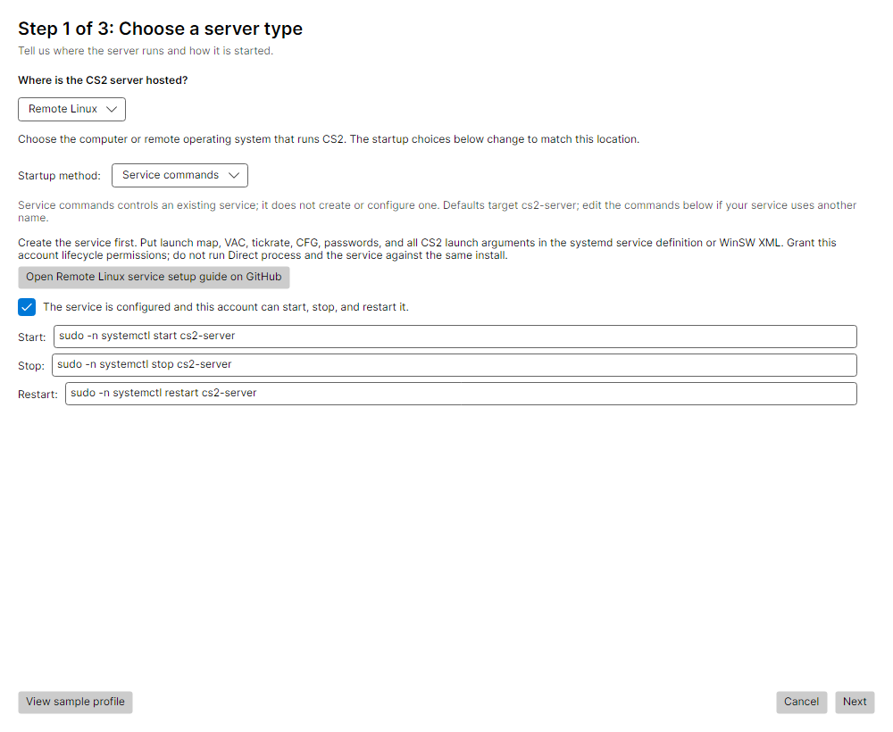 | 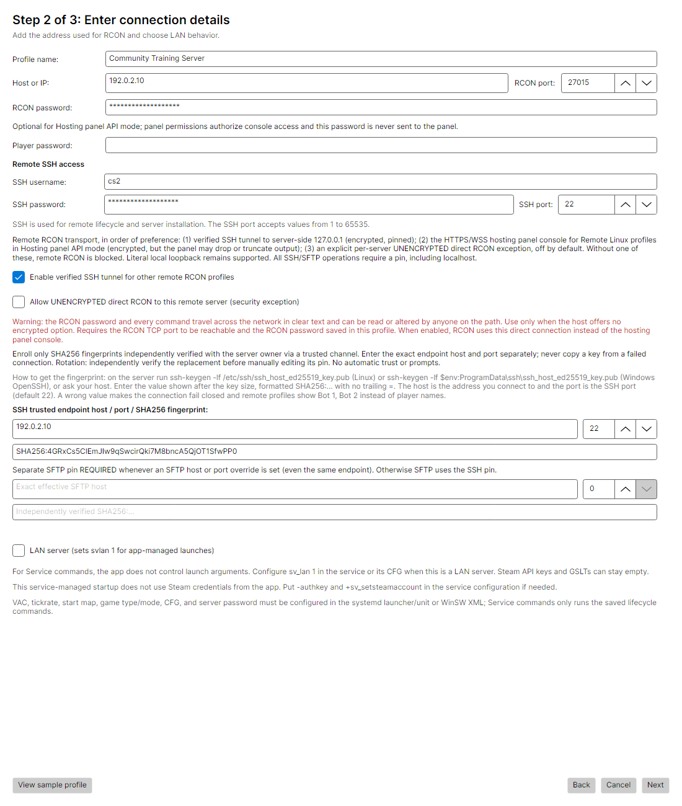 |
| Review and installation | Saved servers |
| 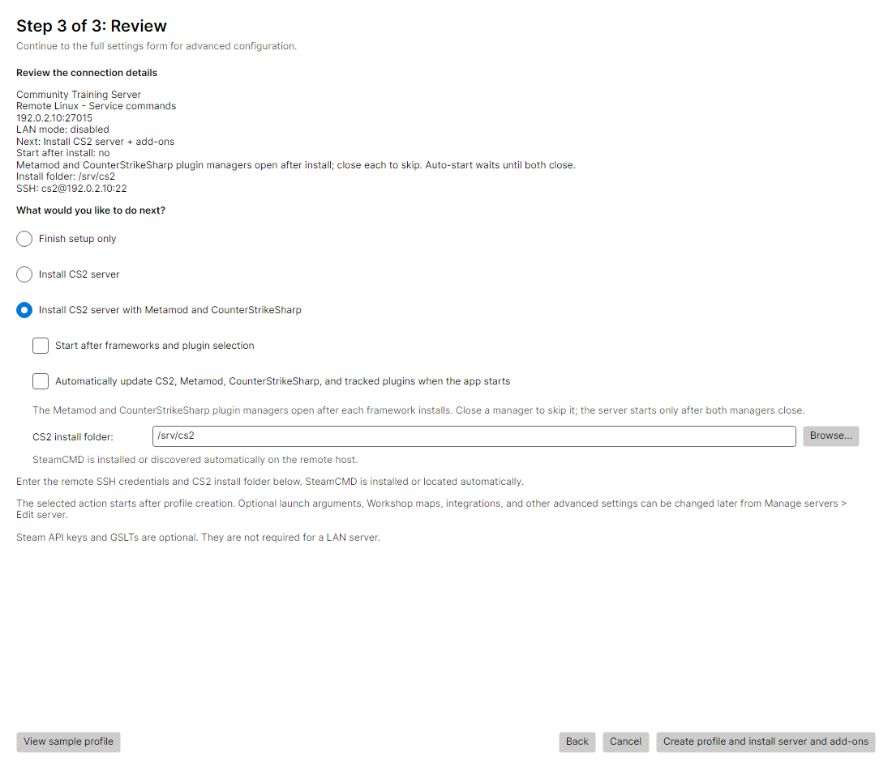 | 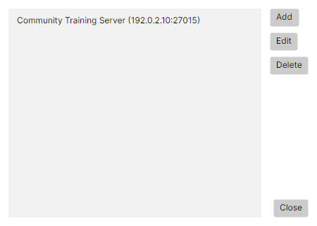 |

### 2. Configure the remote server

| Remote transport security | Integrations |
| --- | --- |
| 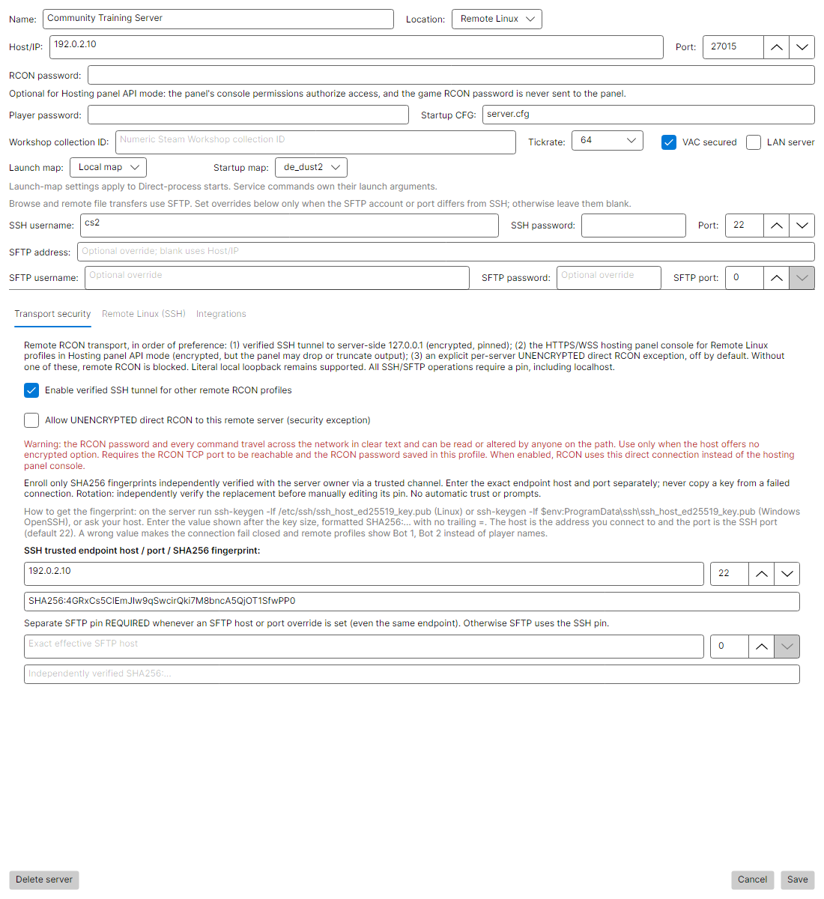 | 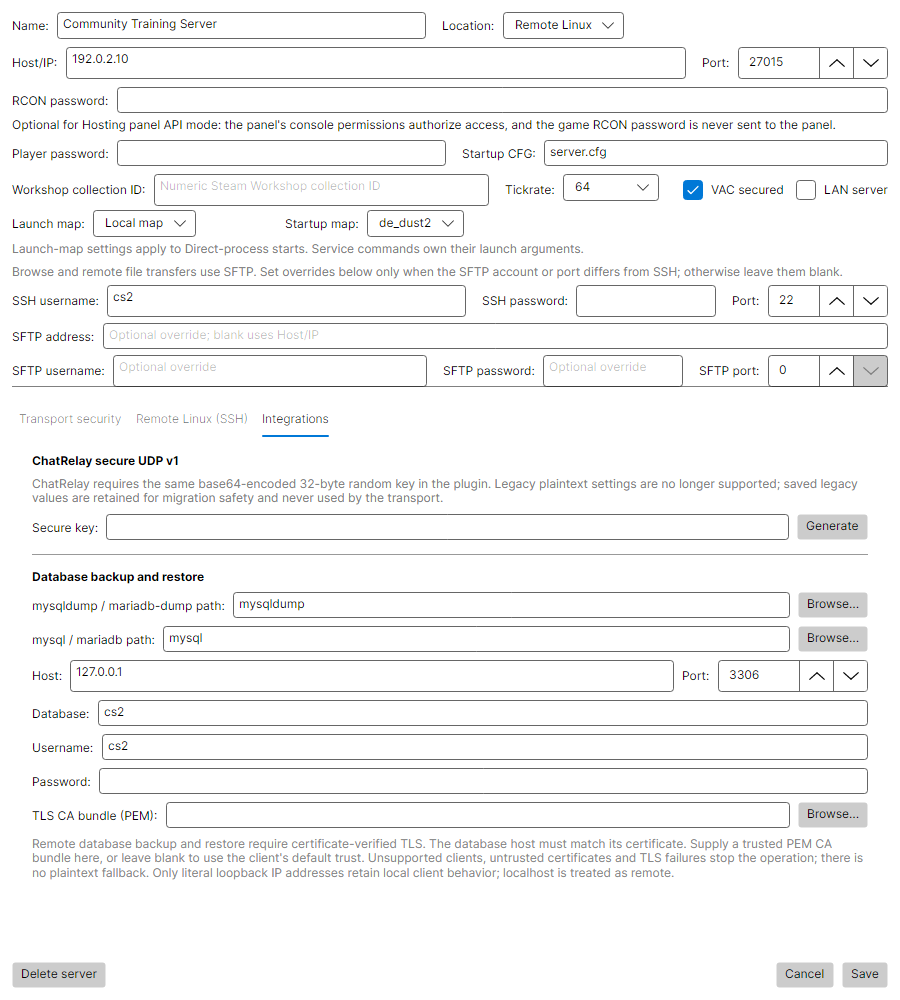 |

**Plugin management**

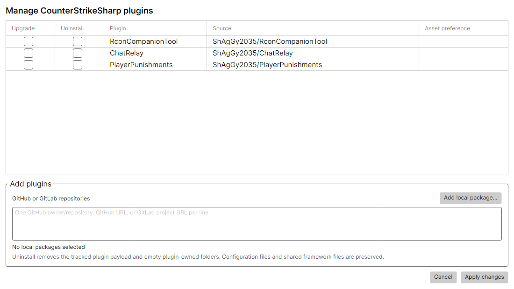

### 3. Server commands and gameplay

| Console commands | Bot Control |
| --- | --- |
| 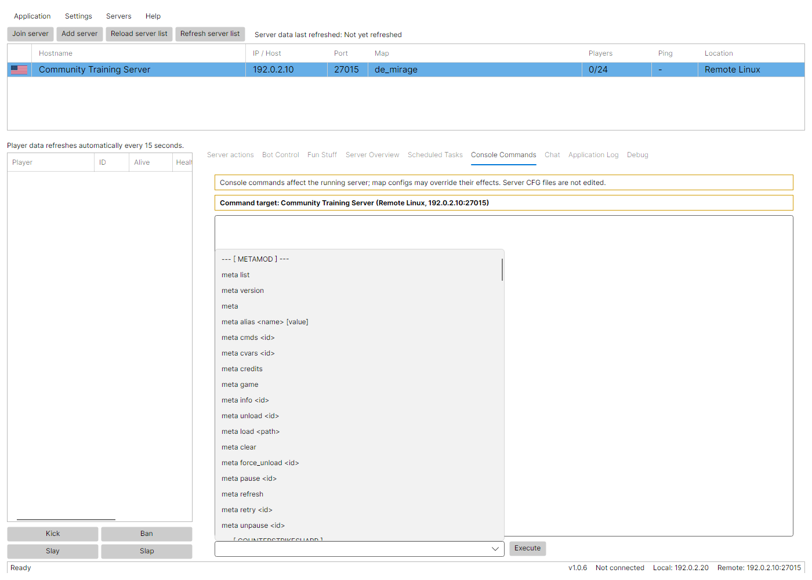 | 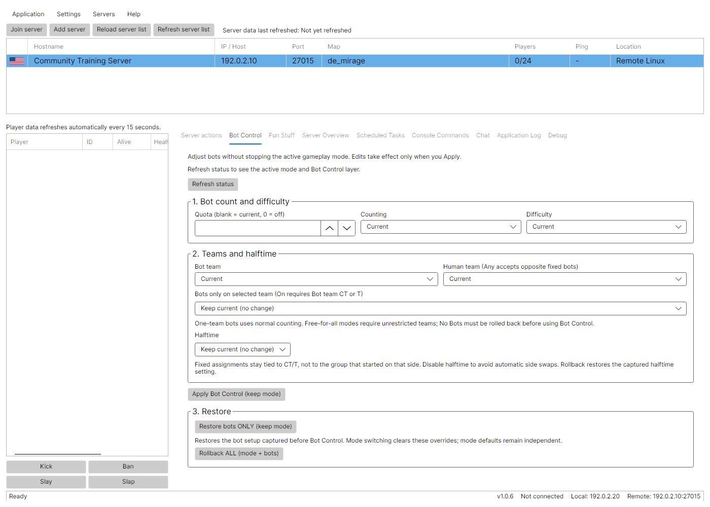 |

**Fun Stuff modes**

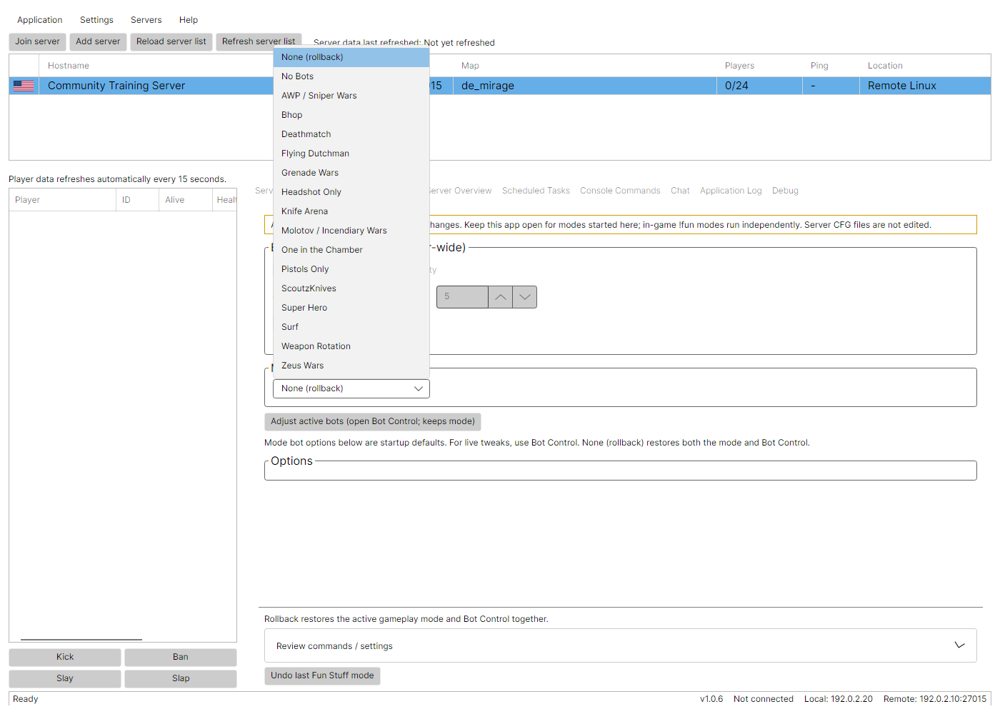

### 4. Schedule tasks

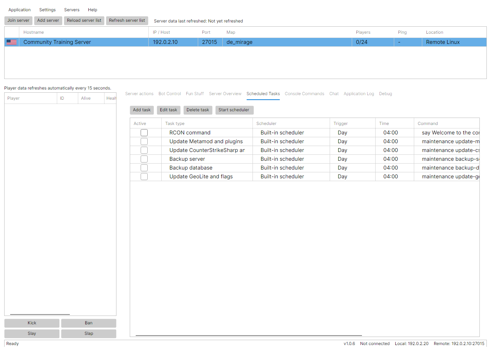

### 5. Chat and troubleshooting

| Chat | Debug output |
| --- | --- |
| 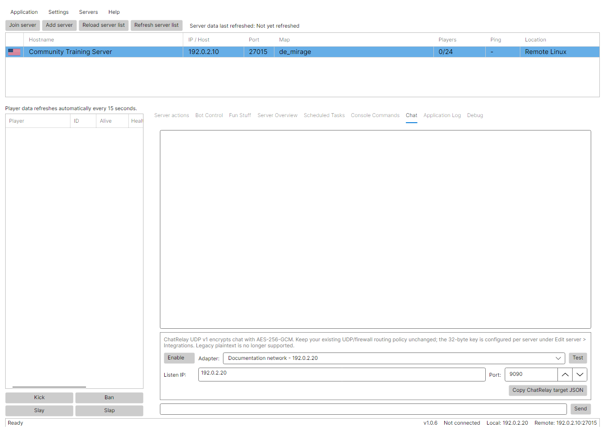 | 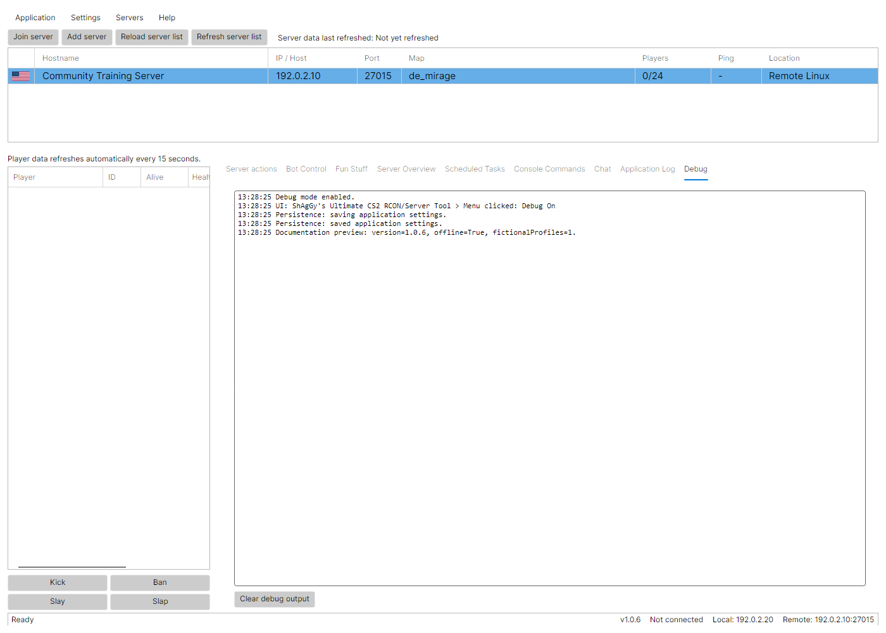 |

### 6. Application preferences

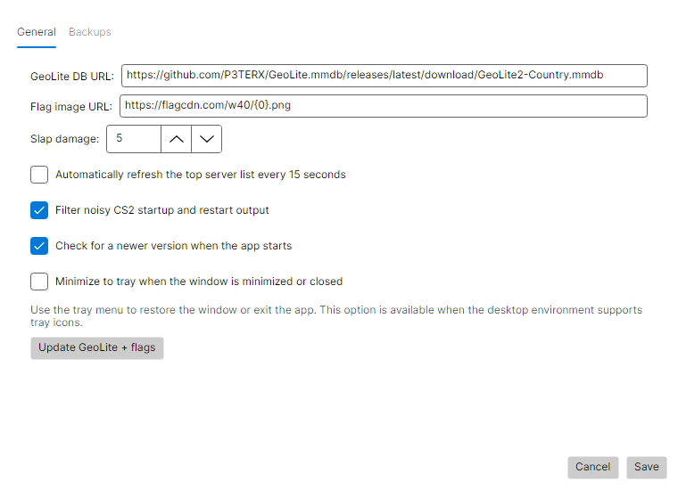
