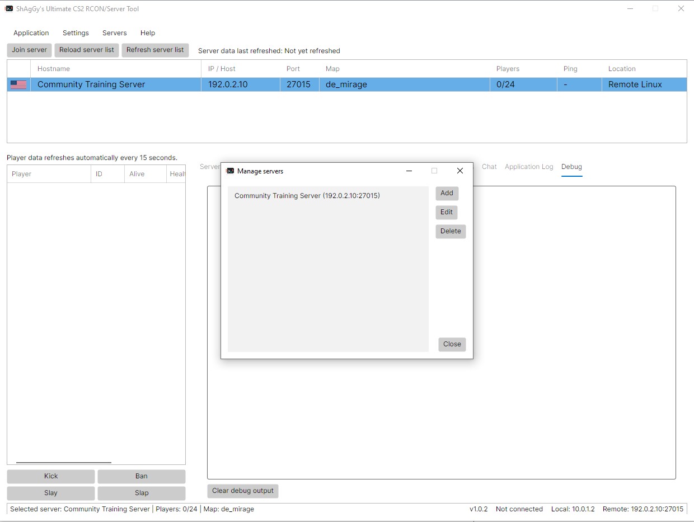
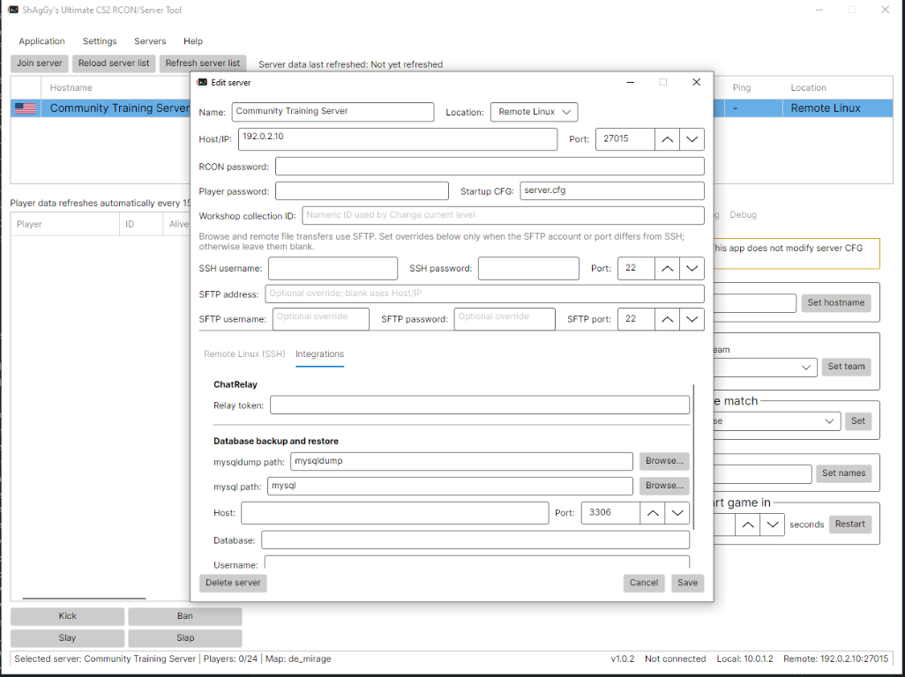
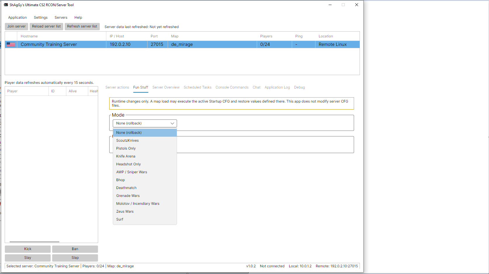
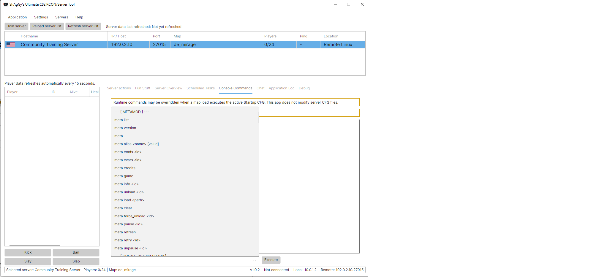
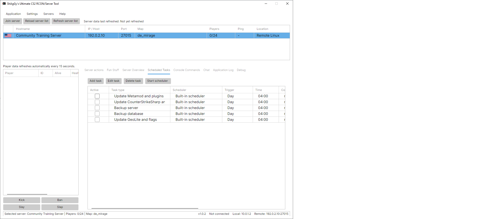
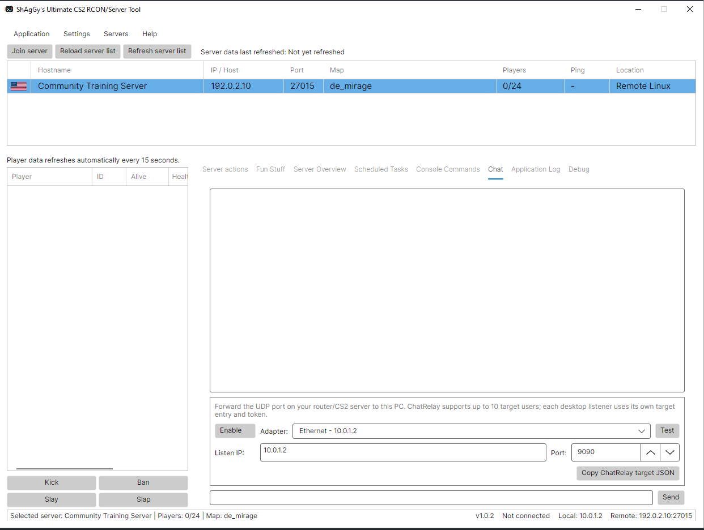
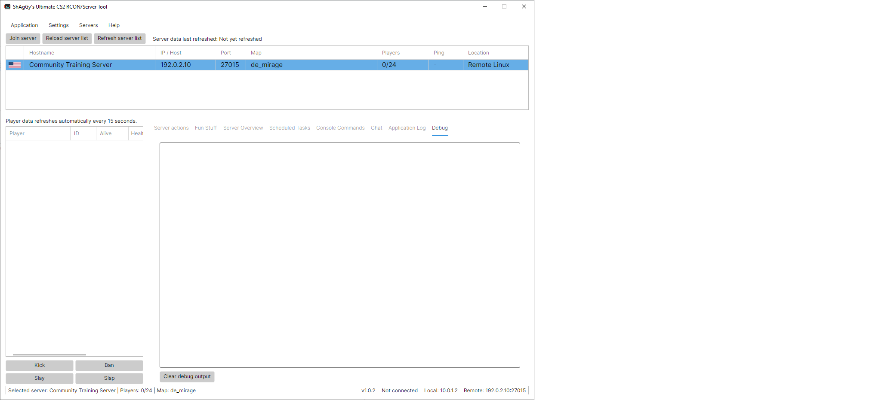
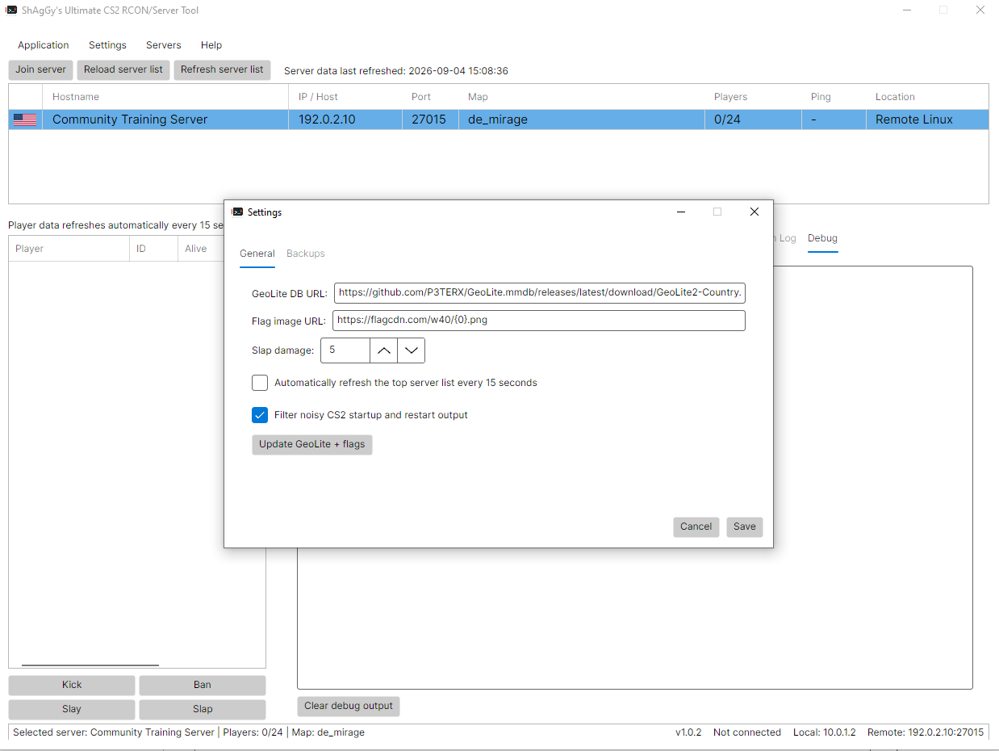

# Ultimate CS2 RCON and Server Management Tool - macOS Guide

Version: 1.0.5

This self-contained guide covers the macOS application packages and Remote Linux or Remote Windows server management. Valve does not publish a native macOS CS2 dedicated-server runtime, so macOS cannot use Local Linux or Local Windows profiles.

[README.md](README.md) provides the project-wide GitHub overview. This file contains all instructions needed for the macOS package.

## Issues

Report application issues at https://github.com/ShAgGy2035/Ultimate-RCON-Server-Tool/issues/new.

## Table of Contents

- [Requirements](#requirements)
- [Install And Launch](#install-and-launch)
- [Update The Application](#update-the-application)
- [Create A Remote Profile](#create-a-remote-profile)
- [Choose A Lifecycle Mode](#choose-a-lifecycle-mode)
- [Remote Linux Setup](#remote-linux-setup)
- [Remote Linux Hosting Panel](#remote-linux-hosting-panel)
- [Remote Linux Account And Permissions](#remote-linux-account-and-permissions)
- [Finish Remote Linux Setup](#finish-remote-linux-setup)
- [Remote Windows Setup](#remote-windows-setup)
- [Create The Windows SSH User](#create-the-windows-ssh-user)
- [Finish Remote Windows Setup](#finish-remote-windows-setup)
- [Using The Application](#using-the-application)
- [RCON Tool Companion And Fun Stuff](#rcon-tool-companion-and-fun-stuff)
- [PlayerPunishments](#playerpunishments)
- [ChatRelay](#chatrelay)
- [Frameworks, Plugins, And Backups](#frameworks-plugins-and-backups)
	- [Install Frameworks And Plugins](#install-frameworks-and-plugins)
- [macOS Integration](#macos-integration)
- [Troubleshooting](#troubleshooting)
- [About](#about)
- [Application Screenshots](#application-screenshots)

## Requirements

- macOS 12.0 or later.
- The x64 package for an Intel Mac or the arm64 package for Apple Silicon.
- Network access from the Mac to the CS2 server's RCON TCP port.
- SSH access to the target computer for remote lifecycle, installation, and file operations.

## Install And Launch

Extract the matching package and open `CS2 RCON Tool.app`.

The packages are self-contained and do not require a separate .NET installation. They are currently unsigned and not notarized. If Gatekeeper quarantines a test build, open Terminal in the extracted directory and run:

```bash
xattr -dr com.apple.quarantine "CS2 RCON Tool.app"
chmod +x "CS2 RCON Tool.app/Contents/MacOS/cs2-rcon-tool"
open "CS2 RCON Tool.app"
```

## Update The Application

Close the application, extract the new package, and replace the entire `CS2 RCON Tool.app` bundle. Do not merge files inside the old bundle.

Writable settings are typically stored under:

```text
~/Library/Application Support/CS2RconTool
```

Back up that entire directory, including `credential.key`, before updating. Saved secrets use AES-256-GCM, so keep the key with the profile and settings JSON files during migration.

## Create A Remote Profile

1. Open **Servers > Manage servers**.
2. Add either **Remote Linux (SSH)** or **Remote Windows (SSH)** according to the target server's operating system.
3. Enter the SSH host, port, username, and password.
4. Enter optional separate SFTP details, or leave them blank to reuse the SSH connection.
5. Choose **Direct process** or **Service commands**.
6. Complete the lifecycle and SteamCMD settings described in the matching target-server guide.
7. Enter the server address, game/RCON port, and RCON password.
8. Save the profile and select it in the main server list.

Imported Local Linux or Local Windows profiles may be displayed, but local lifecycle and installation actions cannot run on macOS. Convert them to the correct Remote profile type and replace local paths with paths valid on the target server.

## Choose A Lifecycle Mode

### Direct Process

Choose Direct process when the application should start and stop the remote CS2 executable over SSH.

- Remote Linux setup: [Remote Linux Direct Process](#remote-linux-direct-process)
- Remote Windows setup: [Remote Windows Direct Process](#remote-windows-direct-process)

The application supplies the selected tickrate, VAC state, and LAN mode for Direct-process launches. Direct mode does not provide automatic startup at target-system boot or automatic restart after a crash. macOS manages remote servers only, so **Start server without validation** is not a local macOS launch option; normal remote Start runs SteamCMD validation when the profile has the required SteamCMD and install-directory settings, while Restart skips validation.

### Service Commands

Choose Service commands when systemd or a Windows service wrapper already owns CS2.

- Remote Linux systemd setup: [Remote Linux Service Commands With systemd](#remote-linux-service-commands-with-systemd)
- Remote Windows WinSW setup: [Remote Windows Service Commands With WinSW](#remote-windows-service-commands-with-winsw)

The application executes configured Start, Stop, and Restart commands; it does not install the service. Put CS2 launch settings such as `-tickrate`, `+sv_lan`, and `-secure` or `-insecure` in the target service configuration.

Stop the current owner before switching lifecycle modes. Direct process and Service commands must not manage the same executable and port simultaneously.

Normal remote **Start server** runs SteamCMD validation before startup when the profile has the required SteamCMD and install-directory settings. **Validate server files** can validate the remote installation without starting CS2, while **Install/Update Server** updates, repairs, and validates it. **Restart server** skips validation.

## Remote Linux Setup

Configure SSH host, port, username, password, optional SFTP details, SteamCMD path, install directory, App ID `730`, and login, normally `anonymous`. Blank SFTP values reuse SSH details; port `0` reuses the SSH port, and valid ports range through `65535`. The account must run lifecycle commands and read/write the installation.

### Remote Linux Hosting Panel

For a hosting provider that exposes a Pterodactyl-compatible panel but does not provide SSH, use **Hosting panel API** for the remote lifecycle mode. Enter the panel URL, server identifier/UUID, and a client API key with power-control permission. Keep SFTP credentials configured for plugin deployment, browsing, and file operations. Start, Stop, and Restart use the panel API and wait for `offline` or `running`; SteamCMD validation and remote shell operations are unavailable. Debug Mode records panel requests and state polling without logging the API key.

### Remote Linux Account And Permissions

Prepare the remote accounts before configuring the macOS profile. The **SSH control account** is the username entered in the profile; it runs lifecycle commands and performs SFTP browsing, file transfers, plugin operations, backups, and SteamCMD operations. The **service account** owns and runs CS2 when using Service commands with systemd. These can be the same account, or they can be separate accounts.

The simplest setup uses the Linux account that owns the CS2 installation for both SSH and SFTP. If a dedicated SSH account does not already exist, create it as an administrator on the remote host and grant it SSH access:

```bash
sudo adduser <ssh-user>
sudo passwd <ssh-user>
```

Do not use `root` as the application, SteamCMD, or CS2 account. The SSH control account must be able to traverse every parent directory and read and write the CS2 installation. If it differs from the service account, grant access through a shared group or filesystem ACL rather than making the installation world-writable.

If the systemd service account does not already exist, create it before installing or assigning ownership of the CS2 files. It may be the same account as `<ssh-user>`:

```bash
sudo adduser <service-user>
```

Verify access before saving the macOS profile. Replace the placeholders with the configured account and install directory:

```bash
namei -l "<install-dir>/game/csgo"
sudo -u <ssh-user> test -r "<install-dir>/game/csgo/gameinfo.gi"
sudo -u <ssh-user> touch "<install-dir>/game/csgo/.rcon-tool-write-test"
sudo -u <ssh-user> rm "<install-dir>/game/csgo/.rcon-tool-write-test"
```

Prefer a shared group or ACL instead of world-writable permissions:

```bash
sudo setfacl -m u:<ssh-user>:x "<parent-directory>"
sudo setfacl -R -m u:<ssh-user>:rwX "<install-dir>"
sudo setfacl -R -d -m u:<ssh-user>:rwX "<install-dir>"
```


### Remote Linux Direct Process

For `/home/cs2/cs2server`, blank fields derive:

```text
Executable:        /home/cs2/cs2server/game/bin/linuxsteamrt64/cs2
Working directory: /home/cs2/cs2server/game (But not required)
```

Set map, game type, game mode, and optional additional arguments. The application supplies `-dedicated`, `-console`, port, hostname, map, CFG, RCON password, tickrate, LAN mode, and VAC state. The default `-ip 0.0.0.0` binds CS2 to all available network addresses; replace `0.0.0.0` with a specific address in the launch arguments when direct interface binding is required. Use a path-specific Stop command:

```bash
executable='/home/cs2/cs2server/game/bin/linuxsteamrt64/cs2'; for process in /proc/[0-9]*; do target=$(readlink "$process/exe" 2>/dev/null || true); if [ "$target" = "$executable" ]; then kill -TERM "${process##*/}"; fi; done
```

Start refuses to run during an app `730` SteamCMD update, verifies `game/csgo/gameinfo.gi`, supplies required native-library paths, launches detached from SSH, and monitors for 30 seconds. Output is captured in `/tmp/cs2-rcon-tool-startup-<port>.log`. Direct mode refuses to control an executable owned by the active `cs2-server` systemd cgroup.


### Remote Linux Service Commands With systemd

The application controls an existing service; it does not create privileged unit or sudoers files. Create `/usr/local/libexec/cs2-rcon-tool-start` after replacing placeholders:

```bash
#!/usr/bin/env bash
export HOME="<service-home>"
export LD_LIBRARY_PATH="<install-dir>/game/bin/linuxsteamrt64:<install-dir>/game/csgo/bin/linuxsteamrt64:<install-dir>/.steam/sdk64:<install-dir>/steamcmd/linux64${LD_LIBRARY_PATH:+:$LD_LIBRARY_PATH}"
cd "<install-dir>/game"
"<install-dir>/game/bin/linuxsteamrt64/cs2" \
	-dedicated -ip 0.0.0.0 -high -nobreakpad -nomemorystats -nojoy \
	+sv_hibernate_when_empty 0 +map de_dust2 +game_type 0 +game_mode 1 \
	+exec server.cfg -console -port 27015 -tickrate 64 -secure +sv_lan 0 \
	+hostname "CS2 Server" -usercon +rcon_password "<rcon-password>" &
child=$!
shutdown() { kill -TERM "$child" 2>/dev/null || true; wait "$child" 2>/dev/null || true; exit 0; }
trap shutdown TERM INT
wait "$child"
exit $?
```

Create `cs2-server.service`:

```ini
[Unit]
Description=Counter-Strike 2 Dedicated Server
After=network-online.target
Wants=network-online.target
StartLimitIntervalSec=300
StartLimitBurst=5

[Service]
Type=simple
User=<service-user>
Group=<service-group>
ExecStart=/usr/local/libexec/cs2-rcon-tool-start
Restart=on-failure
RestartSec=5
TimeoutStopSec=30
KillSignal=SIGTERM
KillMode=mixed

[Install]
WantedBy=multi-user.target
```

Grant the SSH account only the required lifecycle commands:

```sudoers
<ssh-user> ALL=(root) NOPASSWD: /usr/bin/systemctl start cs2-server, /usr/bin/systemctl stop cs2-server, /usr/bin/systemctl restart cs2-server, /usr/bin/systemctl status cs2-server, /usr/bin/systemctl is-active cs2-server
```

Configure the profile:

```text
Startup mode: Service commands
Start:   sudo -n systemctl start cs2-server
Stop:    sudo -n systemctl stop cs2-server
Restart: sudo -n systemctl restart cs2-server
Remote install directory: <install-dir>
```

All CS2 arguments belong in the launcher; the default `-ip 0.0.0.0` binds to all available network addresses and can be replaced with a specific address. Start validates when SteamCMD and the install directory are configured, then requires the service-owned process to remain alive for 30 seconds. Restart skips validation. Stop verifies that it exits.


### Finish Remote Linux Setup

After the Remote Linux profile and its Direct process or Service commands setup are complete:

1. Save the server profile.
2. Select the server in the top server list.
3. Right-click the server and select **Install/Update server...** to install or validate CS2 with SteamCMD.
4. If you also need the supported frameworks and tracked plugins maintained, select **Install/Update Server + Add-ons** instead.
5. Confirm the remote Linux firewall allows the configured game port over UDP and RCON port over TCP.
6. Wait for the operation to finish and review **Console Commands**, **Application Log**, or **Debug**, then right-click the server again and select **Start server**.

If you selected **Install/Update server...** without add-ons, install the frameworks first:

1. Right-click the running server and select **Install/Upgrade Metamod**. Choose a compatible release or paste the direct package URL, then wait for installation to finish.
2. Right-click the server again and select **Install/Upgrade CSS**. Choose a compatible release or paste the direct package URL, then wait for installation to finish.

Whether you selected **Install/Update server...** or **Install/Update Server + Add-ons**, the next step is to install the optional CSS plugins:

1. Right-click the running server and select **Install/Upgrade CSS Plugins...**. Paste each of these URLs into the plugin window:
```text
https://github.com/ShAgGy2035/RconCompanionTool
https://github.com/ShAgGy2035/ChatRelay
https://github.com/ShAgGy2035/PlayerPunishments
```
2. Right-click the server and select **Restart server** so the frameworks and plugins load.

Once installation is complete, continue to the corresponding sections for configuration and usage details:

- [RCON Tool Companion and Fun Stuff](#rcon-tool-companion-and-fun-stuff)
- [PlayerPunishments](#playerpunishments)
- [ChatRelay](#chatrelay)
- [Install Frameworks And Plugins](#install-frameworks-and-plugins) for Metamod, CounterStrikeSharp, and optional CSS plugin details.


## Remote Windows Setup

Configure OpenSSH access, optional SFTP details, Windows SteamCMD path, and CS2 installation directory. The SSH account must belong to the remote computer's local Administrators group for WMI process creation and firewall configuration. Remote Windows management does not require WinRM or a separate SFTP service for Direct startup and plugin deployment.

### Create The Windows SSH User

Perform this setup on the remote Windows computer from an elevated PowerShell prompt, before configuring the macOS profile. Windows OpenSSH provides both SSH and SFTP; a separate SFTP server is not required. Use an existing suitable account instead if one is already available.

Create a dedicated local account such as `cs2tool` and initially add it to the standard Users group:

```powershell
$sshUser = 'cs2tool'
$sshPassword = Read-Host 'Password for cs2tool' -AsSecureString
New-LocalUser -Name $sshUser -Password $sshPassword -Description 'CS2 RCON Tool remote management'
Add-LocalGroupMember -Group 'Users' -Member $sshUser
```

For this application's Remote Windows Direct process workflow, also add the account to local Administrators. The app uses WMI to launch CS2 and configures Windows Firewall rules; this was required by the tested setup:

```powershell
Add-LocalGroupMember -Group 'Administrators' -Member $sshUser
```

Install and enable OpenSSH Server. The capability check avoids reinstalling it when it is already present:

```powershell
$openssh = Get-WindowsCapability -Online | Where-Object Name -Like 'OpenSSH.Server*'
if ($openssh.State -ne 'Installed') {
	Add-WindowsCapability -Online -Name OpenSSH.Server~~~~0.0.1.0
}
Set-Service -Name sshd -StartupType Automatic
Start-Service sshd
```

Allow inbound SSH if Windows did not create its firewall rule:

```powershell
if (-not (Get-NetFirewallRule -Name 'OpenSSH-Server-In-TCP' -ErrorAction SilentlyContinue)) {
	New-NetFirewallRule -Name 'OpenSSH-Server-In-TCP' -DisplayName 'OpenSSH Server (sshd)' -Enabled True -Direction Inbound -Protocol TCP -Action Allow -LocalPort 22
}
```

Open `C:\ProgramData\ssh\sshd_config` as an administrator and make sure password authentication is enabled:

```text
PasswordAuthentication yes
```

Restart SSH after changing the file and verify it is listening:

```powershell
Restart-Service sshd
Get-Service sshd
Get-NetTCPConnection -LocalPort 22 -State Listen
```

Use a simple writable CS2 path such as `C:\CS2Server`, then grant the SSH account Modify access:

```powershell
New-Item -ItemType Directory -Path 'C:\CS2Server' -Force
icacls 'C:\CS2Server' /grant "${sshUser}:(OI)(CI)M" /T
```

From the Mac running the application, test both SSH and SFTP before configuring the profile:

```bash
ssh cs2tool@<remote-windows-host>
sftp cs2tool@<remote-windows-host>
```

Use the account password, confirm SFTP can enter and write to `C:\CS2Server`, then exit both sessions. Use the same username and password in the application profile, and leave separate SFTP fields blank so the app reuses the SSH connection.

### Remote Windows Direct Process

For `C:\cs2server`, blank fields derive:

```text
Executable:        C:\cs2server\game\bin\win64\cs2.exe
Working directory: C:\cs2server\game (But not required)
SteamCMD path:     C:\cs2server-steamcmd\steamcmd.exe
```

The application supplies `-dedicated`, `-console`, `-ip 0.0.0.0`, port, hostname, map, game type, game mode, CFG, RCON password, tickrate, LAN mode, and VAC state. `0.0.0.0` binds to all available network addresses; replace it with a specific address in the launch arguments when you need to bind directly to one interface. Start transfers a temporary PowerShell launcher over SSH, launches through WMI independently of the SSH session, creates UDP/TCP firewall rules, captures output, and monitors for 30 seconds. Direct mode refuses to control an executable owned by the active `cs2-server` service.


### Remote Windows Service Commands With WinSW

Windows service mode requires a wrapper because `cs2.exe` does not implement the Service Control Manager protocol. From Administrator PowerShell on the Windows server:

Keep the desktop app unelevated. During service setup, the Windows administrator must authorize the remote account to control the service and write to the installation. Universal does not elevate itself or change service permissions. See the [service-specific permission setup](README-WINDOWS.md#service-control-without-elevation); perform it on the Windows target, not the Mac.

```powershell
$ErrorActionPreference = 'Stop'
$ProgressPreference = 'SilentlyContinue'
New-Item -ItemType Directory -Force -Path C:\Services\cs2-server | Out-Null
Invoke-WebRequest -Uri 'https://github.com/winsw/winsw/releases/download/v2.12.0/WinSW-x64.exe' -OutFile 'C:\Services\cs2-server\cs2-server.exe'
```

Create `C:\Services\cs2-server\cs2-server.xml` beside the matching `cs2-server.exe`. `<id>` and `<executable>` are required; `<name>` is the display name in Services. Replace the password after `+rcon_password` in `<arguments>` with the RCON password in Universal. Steam API key (`-authkey`) and GSLT (`+sv_setsteamaccount`) are optional: remove those switches if unused, or supply valid values. Replace paths, hostname, and map; XML-escape `&`, `<`, and `>` in values.

```xml
<service>
	<id>cs2-server</id>
	<name>CS2 Dedicated Server</name>
	<description>Counter-Strike 2 Dedicated Server managed by CS2 RCON Tool</description>
	<executable>C:\cs2server\game\bin\win64\cs2.exe</executable>
	<arguments>-dedicated -console -usercon -port 27015 -tickrate 64 -secure -ip 0.0.0.0 +sv_lan 0 +map de_dust2 +game_type 0 +game_mode 1 +exec server.cfg +hostname "CS2 Server" +rcon_password "&lt;rcon-password&gt;" -authkey "&lt;steam-api-key&gt;" +sv_setsteamaccount "&lt;gslt&gt;"</arguments>
	<workingdirectory>C:\cs2server\game</workingdirectory>
	<env name="SteamAppId" value="730" />
	<env name="SteamGameId" value="730" />
	<startmode>Automatic</startmode>
	<stoptimeout>30 sec</stoptimeout>
	<onfailure action="restart" delay="10 sec" />
	<logpath>C:\cs2server\logs</logpath>
	<log mode="roll-by-size"><sizeThreshold>10240</sizeThreshold><keepFiles>8</keepFiles></log>
</service>
```

Before first start, prepare Valve's Steamworks SDK Redist app `1007` on the Windows computer. A LocalSystem service cannot rely on your desktop Steam installation. Missing runtime files can cause **Could not determine Steam client install directory** and a repeated crash/restart loop. In Administrator PowerShell, with the service and any Direct-process instance stopped, adjust these sample paths:

```powershell
$ErrorActionPreference = 'Stop'
$installDir = 'C:\cs2server'
$steamCmdPath = 'C:\cs2server-steamcmd\steamcmd.exe'
$runtimeDir = Join-Path (Split-Path -Parent $steamCmdPath) 'steamworks-sdk-redist'
$destination = Join-Path $installDir 'game\bin\win64'
& $steamCmdPath +force_install_dir $runtimeDir +login anonymous +app_update 1007 validate +quit
if ($LASTEXITCODE -ne 0) { throw 'SteamCMD runtime installation failed.' }
foreach ($file in @('steamclient64.dll', 'tier0_s64.dll', 'vstdlib_s64.dll')) {
	$source = Get-ChildItem -LiteralPath $runtimeDir -Recurse -File -Filter $file |
		Select-Object -First 1
	if (-not $source) { throw "Missing Steamworks runtime file: $file" }
	Copy-Item -LiteralPath $source.FullName -Destination (Join-Path $destination $file) -Force
}
```

Install only if the service ID is not already registered, and configure the profile:

```powershell
New-Item -ItemType Directory -Force -Path C:\cs2server\logs | Out-Null
Set-Location C:\Services\cs2-server
.\cs2-server.exe install
Start-Service -Name 'cs2-server'
```

```text
Startup mode: Service commands
Start:   powershell -NoProfile -NonInteractive -Command "Start-Service -Name 'cs2-server'"
Stop:    powershell -NoProfile -NonInteractive -Command "Stop-Service -Name 'cs2-server'"
Restart: powershell -NoProfile -NonInteractive -Command "Restart-Service -Name 'cs2-server'"
```

Put all CS2 launch arguments in the WinSW XML. Configure inbound UDP and TCP firewall rules for the game/RCON port. WinSW writes rolled logs under `C:\cs2server\logs` and restarts CS2 after unexpected exits.

`<startmode>Automatic</startmode>` starts the service at Windows boot without Universal; installation alone does not start it. Windows boot and Services commands do not run Universal's SteamCMD validation; normal Start in Universal validates when configured, while Restart skips validation. Confirm CS2 stays running, not just that the wrapper briefly reports Running.

If the service is not visible, press F5 in `services.msc` and look for its display name, or run `Get-Service -Name 'cs2-server'`. To locate the installed wrapper, run `Get-CimInstance Win32_Service -Filter "Name='cs2-server'" | Select-Object Name, DisplayName, State, PathName`. For Error 1053, check XML syntax, closed tags, and paths; inspect `cs2-server.wrapper.log` and CS2 output under `<logpath>`. Wrapper logs contain launch credentials: redact them before sharing.

To reuse a service with a different CS2 directory, stop it and update `<executable>`, `<workingdirectory>`, `<logpath>`, launch arguments, and firewall paths. Keep the registered wrapper path and `<id>` unchanged. Moving the wrapper itself requires uninstalling from the old location and installing from the new one; changing only the CS2 directory does not.


### Finish Remote Windows Setup

After the Remote Windows profile and its Direct process or Service commands setup are complete:

1. Save the server profile.
2. Select the server in the top server list.
3. Right-click the server and select **Install/Update server...** to install or validate CS2 with SteamCMD.
4. If you also need the supported frameworks and tracked plugins maintained, select **Install/Update Server + Add-ons** instead.
5. Confirm the remote Windows firewall allows the configured game port over UDP and RCON port over TCP.
6. Wait for the operation to finish and review **Console Commands**, **Application Log**, or **Debug**, then right-click the server again and select **Start server**.

If you selected **Install/Update server...** without add-ons, install the frameworks first:

1. Right-click the running server and select **Install/Upgrade Metamod**. Choose a compatible release or paste the direct package URL, then wait for installation to finish.
2. Right-click the server again and select **Install/Upgrade CSS**. Choose a compatible release or paste the direct package URL, then wait for installation to finish.

Whether you selected **Install/Update server...** or **Install/Update Server + Add-ons**, the next step is to install the optional CSS plugins:

1. Right-click the running server and select **Install/Upgrade CSS Plugins...**. Paste each of these URLs into the plugin window:

```text
https://github.com/ShAgGy2035/RconCompanionTool
https://github.com/ShAgGy2035/ChatRelay
https://github.com/ShAgGy2035/PlayerPunishments
```
2. Right-click the server and select **Restart server** so the frameworks and plugins load.

Once installation is complete, continue to the corresponding sections for configuration and usage details:

- [RCON Tool Companion and Fun Stuff](#rcon-tool-companion-and-fun-stuff)
- [PlayerPunishments](#playerpunishments)
- [ChatRelay](#chatrelay)
- [Install Frameworks And Plugins](#install-frameworks-and-plugins) for Metamod, CounterStrikeSharp, and optional CSS plugin details.


## Using The Application

Add server provisioning can reuse an existing remote installation. Before changing files, it stops the target through its configured remote lifecycle and verifies stop completion. A failed stop aborts provisioning. Keep other applications from starting the target during provisioning. Start-after-install starts the newly created profile only after all selected stages succeed; if unchecked, or if provisioning fails, the target stays stopped. The remote account needs permission to execute the configured lifecycle commands.
Click **Add server** in the top toolbar, choose Remote Linux or Remote Windows and a supported startup method, then enter the host/IP, RCON port, and RCON password. Enable **LAN server** when appropriate; Steam API keys and GSLTs are optional and are not required for LAN servers. For install actions, the wizard collects the remote install folder and SSH credentials; SteamCMD is installed or discovered automatically. At the end, finish setup or choose an install/update action and optionally start the server after successful installation; Hosting panel API profiles ask who manages frameworks and leave CS2 core updates with the provider. Advanced details remain available through Edit server. RCON uses TCP; opening only the UDP game port is insufficient.

Use **Help > Sample server profile** for a complete read-only example of the available fields. It uses placeholder values and is not added to the server list.

Use **Help > Sample server profile** for a complete read-only example of the available fields. It uses placeholder values and is not added to the server list.

Server Actions controls hostname, bots, teams, passwords, friendly fire, cheats, pause, maps, maximum rounds, timed restarts, and player punishments. These are runtime commands and never edit server CFG files. Deleting a server requires confirmation; optional cleanup removes app state and schedules but never deletes the managed installation, plugins, or backups.

The map selector lists playable maps and configured Workshop maps.

Open **Settings > Settings** for GeoLite/flag URLs, Slap damage, automatic refresh, noisy-output filtering, startup update checks, **Minimize to tray**, and separate backup destinations. Server-specific lifecycle, SteamCMD, Workshop, RCON, database, ChatRelay, and Steam credentials remain under **Servers > Manage servers > Edit server**. **Help > Check for Updates** only notifies and links to GitHub; it never downloads or installs the app.

Console Commands provides free-form RCON and suggestions with separate per-server history. Application Log and Debug retain operation details while redacting credentials. When closing with Debug Mode enabled, choose **Stop debugging** to return to the app or **Exit program** to close.

Scheduled task types include RCON, framework/plugin maintenance, server/database backups, GeoLite/flags, and Fun Stuff rotation (timed steps that start Companion modes in order, then stay, roll back, or repeat; built-in scheduler only), with Day, Hour, and Startup triggers. Built-in tasks need the app open and monitoring active. Native macOS tasks use launchd user agents and the headless runner, so the GUI can remain closed.

## RCON Tool Companion And Fun Stuff

The GUI allows one instance per user/settings directory. Relaunching the shortcut restores the existing window, including from the tray; it does not create another GUI. Headless task/asset commands bypass this guard. Before switching from an older build, use the tray's **Exit** to stop it once, then start the updated app. IPC/startup/relaunch tests passed; actual desktop focus/restoration still needs testing.

With **Minimize to tray** enabled, hiding the window shows an eight-second **Still running in the tray** reminder with Show/Exit actions and a clearer tooltip. It does not take keyboard focus or add a taskbar item; unsupported-tray fallback remains unchanged. Console feedback now identifies expected-silent operations such as `css_plugins reload 9`, distinguishes failed sends, leaves unclassified empty replies unconfirmed, and preserves actual reply/error text. Headless reminder/position and formatter checks passed; desktop tray interactions still need testing.

Long-running monitoring updates player health/status on existing rows rather than rebuilding the player table. Read-only output panes keep bounded text without undo history. These reduce allocation churn; an overnight memory retest of the updated build is still pending.

All Fun Stuff modes require [RCON Tool Companion 1.0.2](https://github.com/ShAgGy2035/RconCompanionTool), built against CounterStrikeSharp API 1.0.376. Validate older or KHS fork runtimes against this Companion build before deployment. Companion includes its own WASD `!fun` menu (**W/S** move, **E** select, **A** back, **R** exit), so no separate menu plugin is required. Administrators with `@css/fun` can use `!fun` or `/fun` without an RCON password, including each mode's `!fun` submenu for bot enablement, quota, and quota mode. By default, Companion rolls back the active mode when the last human player leaves. Upgrading Companion does not add new options to an existing `RCT.json`; missing options use their defaults. See the Companion README's **Upgrading an existing `RCT.json`** section to add them manually or regenerate the file.

Modes include No Bots, AWP/Sniper Wars, Bhop, Deathmatch, Grenade Wars, Molotov/Incendiary Wars, Headshot Only, Knife Arena, Pistols Only, ScoutzKnives, Super Hero, Surf, and Zeus Wars. Super Hero keeps normal weapons and buying and gives every player one enabled power each spawn: Speedster, Moon Jumper, Tank, Ghost, Vampire, Regenerator, Juggernaut, Second Wind, Ammo Recycler, Berserker, Medic, Blink, Double Jump, or Gunslinger. Universal exposes all fourteen toggles and strength controls in its Options panel. The in-game `!fun` mode uses Companion defaults from `RCT.json`. Universal also has a standalone **Bot Control** option, mirrored under `!fun` > Bot control, for bot enablement, quota, quota mode, and team. The `!fun` Bot Control panel stages edits until **Apply now**, which saves preferences to `RCT.json` and applies them to the server. **Bot team** can put every bot on CT or T for lopsided training such as 20 bots against one player. Returning to **Any** restores the original team cvars without kicking bots. No Bots only removes bots, and rollback restores the previous bot quota. All bot quota controls default to `fill`; `normal` and `match` remain selectable. Existing saved quota modes are preserved.

**One in the Chamber** uses the native Deathmatch ruleset with individual FFA scoring, random spawns, a stock Deagle, knife, and exactly one starting bullet. Every non-self kill earns another bullet; missing requires a knife kill to recover ammo. Default Deagle and knife hits are lethal; optional **Deagle headshots only** suppresses Deagle body damage but keeps knife kills lethal. Companion controls respawning with a default one-second delay and the usual bot options. It is available in Universal, `!fun`, and scheduled rotations. Chamber owns its rules and reload handling independently of Deathmatch: entry and rollback each reload the current map, and its guarded five-second map reapply does not restart the round. Buying and C4 objectives are disabled; rollback restores captured settings after map configs load. CT/T assignments may remain internally, but team Deathmatch scoring is disabled. Requires refreshed Companion 1.0.2 (`one-in-the-chamber`, `chamber-native-ffa`). Roll back an active older Chamber session before upgrading. Focused rule, reload-order, restoration, and isolation checks passed; the native HUD/scoring and gameplay still require a live retest.

Active modes are intended to survive map changes. Universal's cvar reapply requires the app to stay open; `!fun` and scheduled modes use Companion's saved-command reapply. Updated Companion 1.0.2 (`mode-map-reapply`) explicitly resets Super Hero's map-specific power state and reassigns powers about five seconds after map start. Existing Deathmatch, No Bots, and Chamber handlers retain their dedicated behavior. The default empty-server rollback still intentionally ends modes when the last human leaves; recovery does not revive a rolled-back mode. Live map-change validation is pending.

Super Hero shows the assigned power name and description in a center-screen popup for five seconds by default, with chat retained as a fallback. **Power popup (seconds)** sets the duration from 0 to 30 (`0` disables); `!fun` uses `SuperHero.PowerNoticeSeconds` in `RCT.json`. Spectators see the power of the living player or bot they watch, and switching targets starts a fresh popup. The notice is informational: it does not freeze movement or replace the `!fun` menu, which pauses its timer. Requires updated Companion 1.0.2 (`superhero-notice`); live HUD/spectator testing is pending.

Updated Companion's `empty-server-grace` keeps the active mode for five minutes after the last human leaves. `EmptyServerRollbackDelaySeconds` in `RCT.json` defaults to `300` (`0`-`3600` allowed). A human returning cancels the pending rollback; the deadline survives map changes and repeated empty checks do not extend it. The roster and transition state are checked again at expiry. Explicit **Rollback** still takes effect immediately. Status reports **Empty-server grace**, **Map transition**, and **Last mode end**. Live transition behavior still needs verification.

Super Hero notices now maintain cached HTML at the same per-tick cadence as `!fun`, with the configured server-side clock controlling when to clear it. This replaces the single-event revision, which was reported to disappear after about one second. Spectator switching and activation instructions such as Blink's Use key are retained; menu pause/resume preserves remaining time. Five-second upkeep checks passed, but visible duration and pulsing still need an in-game retest.

**Fun Stuff > Empty-server rollback (server-wide)** now exposes the automatic rollback toggle and grace period in minutes (default five, range 0-60). The panel reads the selected server's current RCT policy; **Apply settings** saves only that policy in the server's `RCT.json`, without starting or replacing a mode. It applies to all modes, including `!fun` and scheduled rotations. Changes are not sent merely by opening the tab. Requires updated Companion 1.0.2 (`empty-server-settings`); live UI/RCON saving still needs testing.

The refreshed Companion corrects settings saves to `configs/plugins/RCT/RCT.json`, rather than the incorrectly assembly-derived `RconToolCompanion/RconToolCompanion.json` path. Its ZIP now begins at `addons/`; manual extraction belongs in the server's `game/csgo/` directory. Universal's plugin installer recognizes that layout. Do not loosen file permissions to work around the old path mismatch; hosted save access still requires a live retest.

Super Hero spreads enabled powers among living teammates before repeating one. With at least five enabled, a five-player team gets five different powers; larger teams or fewer enabled powers use balanced repeats. CT and T are assigned independently, including bots. Respawns prefer a different power when an equally suitable choice exists.

The eight additional powers provide damage reduction, one-hit survival, magazine refill on enemy kills, low-health bonuses, teammate healing, safe Blink with the Use key, one extra airborne jump, and faster reload completion. They default to enabled, with configurable strengths. Expanded powers require the updated Companion 1.0.2 (`superhero-expanded`) and the full CounterStrikeSharp 1.0.376 runtime, not only its API DLL. Live gameplay still needs testing; see the Companion guide for defaults and input details.

Moon Jumper combines a high launch velocity with reduced gravity. Defaults are **Jump velocity** `1200` units/s (range `300`-`1500`) and **Gravity multiplier** `0.275` (`1` is normal gravity; `0.275` approximates ScoutzKnives' default `sv_gravity 220` on a standard 800-gravity server). Hold Jump as you take off; the boost applies once the pawn is airborne. Enable only Moon Jumper when testing because each spawn otherwise receives a random enabled power. Existing `RCT.json` values are preserved; update `SuperHero.MoonJumperJumpVelocity` manually if `!fun` should use the new default.

The application captures affected values before apply; switching restores the previous mode first, and **None (rollback)** restores the exact snapshot without editing a CFG. Isolated Companion profiles prevent stale cleanup from affecting another mode, and a server-side lock rejects overlapping changes. Managed inventories survive spawns and bot takeovers while preserving the Terrorist bomb carrier's C4. Managed modes clean ground weapons; Headshot Only leaves weapons and buying unchanged.

ScoutzKnives, AWP, Pistols, Knife, Zeus, HE-grenade, and fire-grenade modes use dedicated loadouts. ScoutzKnives and Surf expose their physics controls, also available in `RCT.json`. Deathmatch stages duration and spawn rules before map initialization and reloads the current map when leaving because CS2 only fully exits built-in Deathmatch on a map load. Companion stores its authoritative snapshot under `configs/plugins/RCT`.

## ChatRelay

ChatRelay is a separate [CounterStrikeSharp plugin](https://github.com/ShAgGy2035/ChatRelay); it is not bundled with the macOS app. Install it on the CS2 server, then select the receiving adapter and UDP port in the Chat tab, set a unique token under **Edit server > Integrations**, and use **Copy ChatRelay target JSON** for `TargetIp`, `TargetPort`, and `SharedToken`. The authenticated **Test** action verifies the listener, and admin chat can be sent through RCON.

The listener accepts authenticated JSON only, limits datagrams to 8 KiB, and drops rejected packets. UDP is unencrypted, so restrict firewall access to the server or trusted LAN, or use a VPN.

## PlayerPunishments

The app's Slay and Slap controls send `css_slay #userid` and `css_slap #userid damage`. Install [PlayerPunishments 1.0.0 or newer](https://github.com/ShAgGy2035/PlayerPunishments) on the remote CS2 server when its existing administration package does not provide those commands. PlayerPunishments is a CounterStrikeSharp server plugin and is not installed in the macOS application bundle. Configure Slap damage from `0` to `99` under **Settings > General**.

Alive and Health display **Unknown** when the required server-side player-information command is unavailable.

## Frameworks, Plugins, And Backups

Install Metamod before CounterStrikeSharp. Interactive installation shows the latest 20 compatible releases and accepts a selected release or direct package URL. **Settings > Metamod Settings** manages plugin lifecycle; **Settings > CStrikeSharp Settings** reloads admins and manages plugins; **Test Metamod/CSS command availability** safely probes supported command forms.

### Install Frameworks And Plugins

Install Metamod before CounterStrikeSharp. Use the application menus in this order:

1. Select the configured server in the top server list.
2. Right-click the server and select **Install/Upgrade Metamod**. Choose a compatible release or paste the direct package URL when prompted, then wait for installation to finish.
3. Right-click the server again and select **Install/Upgrade CSS**. Choose a compatible release or paste the direct package URL when prompted, then wait for installation to finish.
4. Right-click the server again and select **Install/Upgrade CSS Plugins...** to install optional CounterStrikeSharp plugins. Paste the plugin's GitHub or supported GitLab repository/release URL, choose the matching release asset if prompted, and wait for deployment to finish.
5. Restart the server after installing or upgrading frameworks or plugins so the server loads them.

Optional plugins can come from GitHub, nested public GitLab.com projects, or supported local packages. Assets are filtered by target server OS, and repeated choices remember a version-independent filename preference. Keep `game/csgo/.cs2-rcon-tool-plugins.json` with the server so uninstall removes only owned files. Remote updates replace native binaries atomically so a running process keeps the old binary until restart.

Use the **Manage Metamod plugins** window only for packages containing an `addons/metamod` payload. Use the **Manage CounterStrikeSharp plugins** window for CounterStrikeSharp plugin packages. The application rejects packages submitted through the wrong manager before deployment.

Server backup includes configuration, add-ons, maps, `gameinfo.gi`, and plugin tracking rather than stock binaries or Workshop downloads. Database backup uses `mysqldump`. Restore accepts ZIP, TAR.GZ, or TGZ; combined update/restore refreshes core files first. Remote operations require suitable SSH permissions and archive tools.

Writable data lives under `~/Library/Application Support/CS2RconTool` and includes profile/settings JSON, Fun Stuff state, `app_state.json`, `credential.key`, GeoLite data, and flags. Startup validates the JSON files and moves invalid files into timestamped `migration-backups` folders. Secrets use AES-256-GCM. Back up the entire directory and preserve `credential.key`; release archives exclude settings, credentials, caches, PDBs, ChatRelay, and Companion binaries.

## macOS Integration

- **Join server** uses the native `open` command for Steam connection URIs.
- If Steam opens CS2 without connecting, the application copies `connect IP:port`; paste it into the CS2 developer console.
- Native scheduled tasks use launchd user agents.
- Built-in scheduled tasks run while the application is open and scheduler monitoring is active.

## Troubleshooting

### RCON commands fail

- Verify that the target server's RCON TCP port is reachable from the Mac.
- Re-enter SSH and RCON credentials after migration when protected values cannot be decrypted.

### A Linux server in a bridged VirtualBox VM is unreachable

- When managing a Linux VM remotely, use the guest's LAN address rather than the Mac host address or `127.0.0.1`.
- If the guest hostname is used, ensure `/etc/hosts` maps `127.0.1.1` to the VM hostname.
- For Direct process mode, keep `-ip 0.0.0.0` in the remote launch arguments for access from the network, or replace it with the guest's specific LAN address. For Service commands mode, put the chosen `-ip` value in the systemd launcher.
- Confirm the VirtualBox adapter is Bridged Adapter mode and that the guest firewall permits the configured game UDP and RCON TCP ports.

### A Windows server in a bridged VirtualBox VM is unreachable

- Use the Windows guest's LAN address rather than the Mac host address or `127.0.0.1`.
- If the guest hostname is used, add its LAN address and hostname to `C:\Windows\System32\drivers\etc\hosts` in the Windows guest. Edit the file as Administrator.
- For Direct process mode, keep `-ip 0.0.0.0` in the remote launch arguments for access from the network, or replace it with the guest's specific LAN address. For Service commands mode, put the chosen `-ip` value in the WinSW XML.
- Confirm the VirtualBox adapter is Bridged Adapter mode and that the Windows guest firewall permits the configured game UDP and RCON TCP ports.
- If VirtualBox created a Host-Only adapter such as `Ethernet 2` and it interferes with routing, disable it on the Mac host while keeping the physical network adapter enabled.

### Local server exits immediately

- macOS cannot run local CS2 profiles. Convert an imported local profile to Remote Linux or Remote Windows and provide valid target paths and credentials.

### Remote lifecycle, browsing, or installation fails

- Re-run the Gatekeeper commands above if macOS blocks a newly extracted unsigned build.
- `Connection refused` means no SSH service accepted the configured host and port; authentication errors mean the SSH username or password was rejected.
- For Linux, verify parent-directory traversal, installation access, `tar`, and `curl`, `wget`, or `python3`.
- For Windows, verify Administrator membership and firewall rules.

### Metamod or CounterStrikeSharp commands are unknown

- Framework installation is performed on the remote CS2 server. Install Metamod before CounterStrikeSharp and restart the server after repairs.

### Join Server opens CS2 but does not connect

- Verify the remote server address and port, then use the copied `connect IP:port` command in the CS2 developer console.

### Chat does not appear

- Verify ChatRelay is running, match the IP, adapter, UDP port, and token, check firewall rules, and use **Test**.

### Scheduled tasks do not run

- Confirm the task is active and valid.
- Start built-in monitoring or inspect the launchd user agent.

### Country or flag data is missing

- Update it under **Settings > General**.
- Confirm direct-download URLs and verify the data directory is writable.

## About

Open **Help > About** to view version `1.0.5`, developer information, and the detected application platform.

## Application Screenshots

| Server management | Integrations |
| --- | --- |
|  |  |
| Fun Stuff | Console commands |
|  |  |
| Scheduled tasks | Chat |
|  |  |
| Debug output | General settings |
|  |  |
