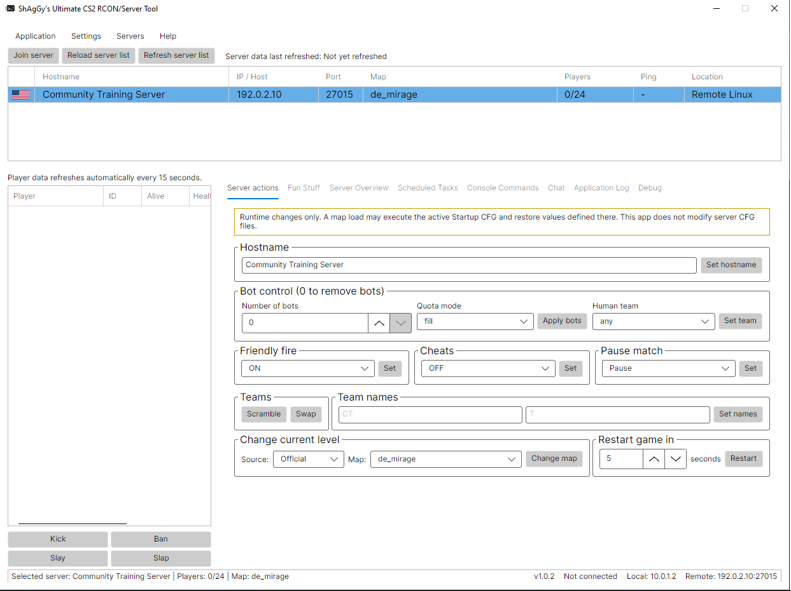
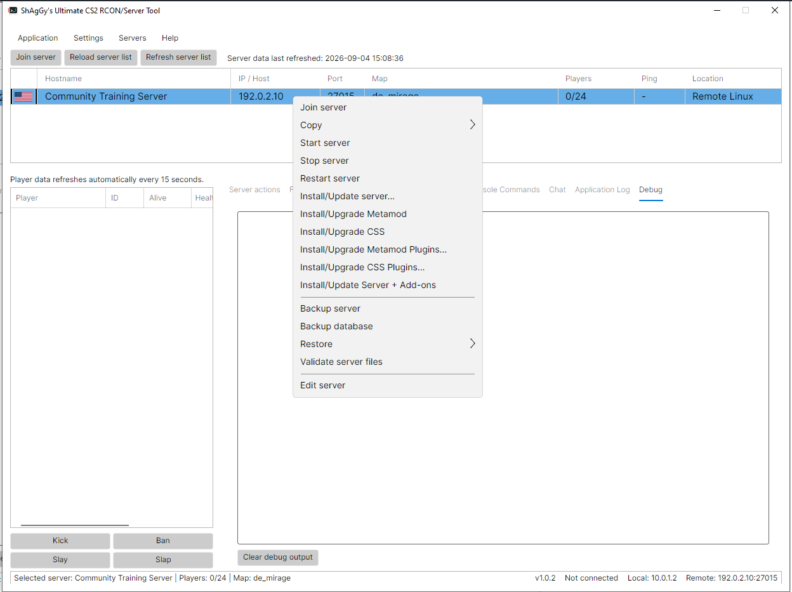
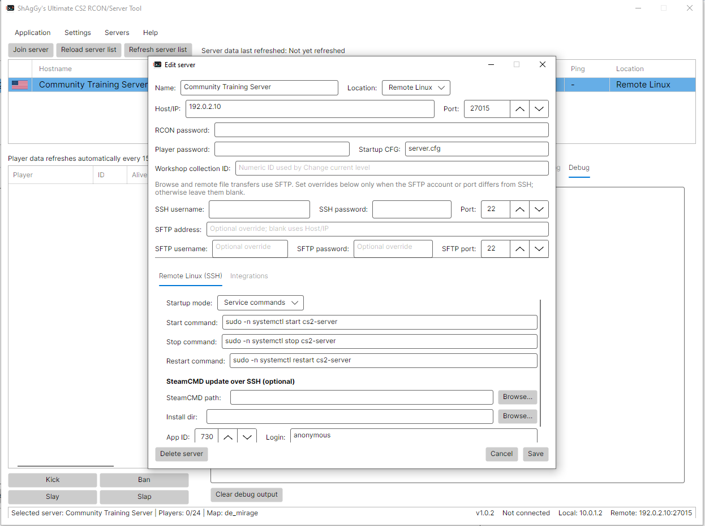
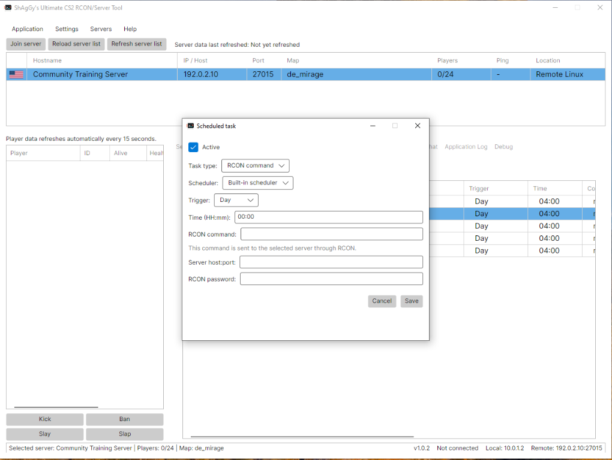
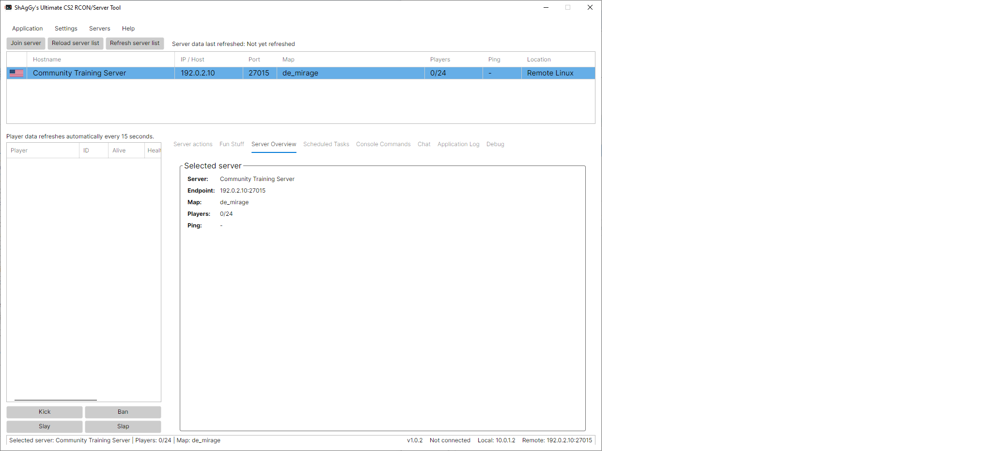
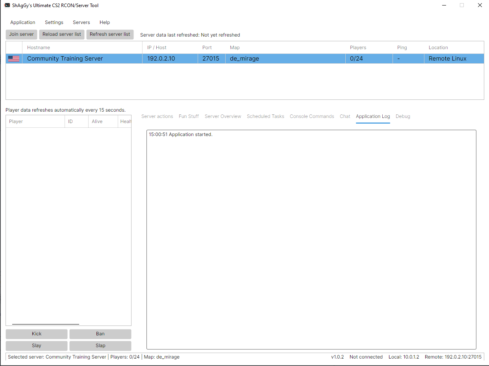
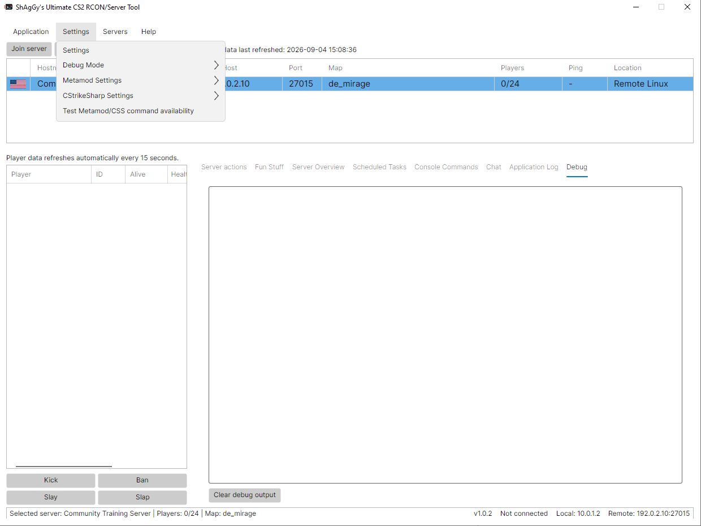
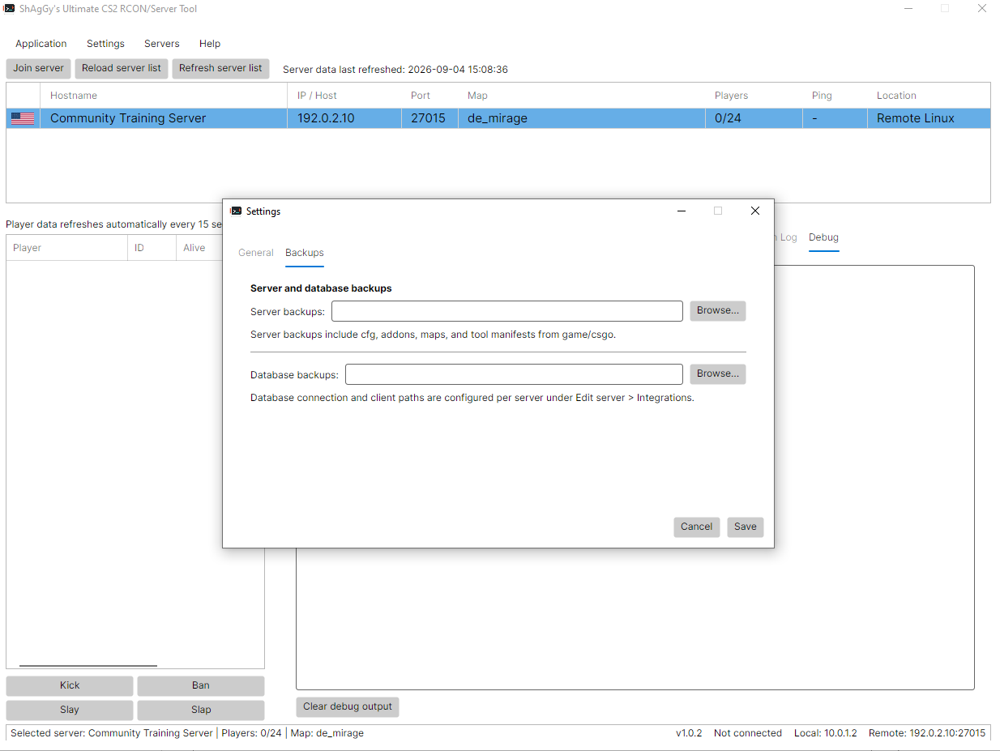
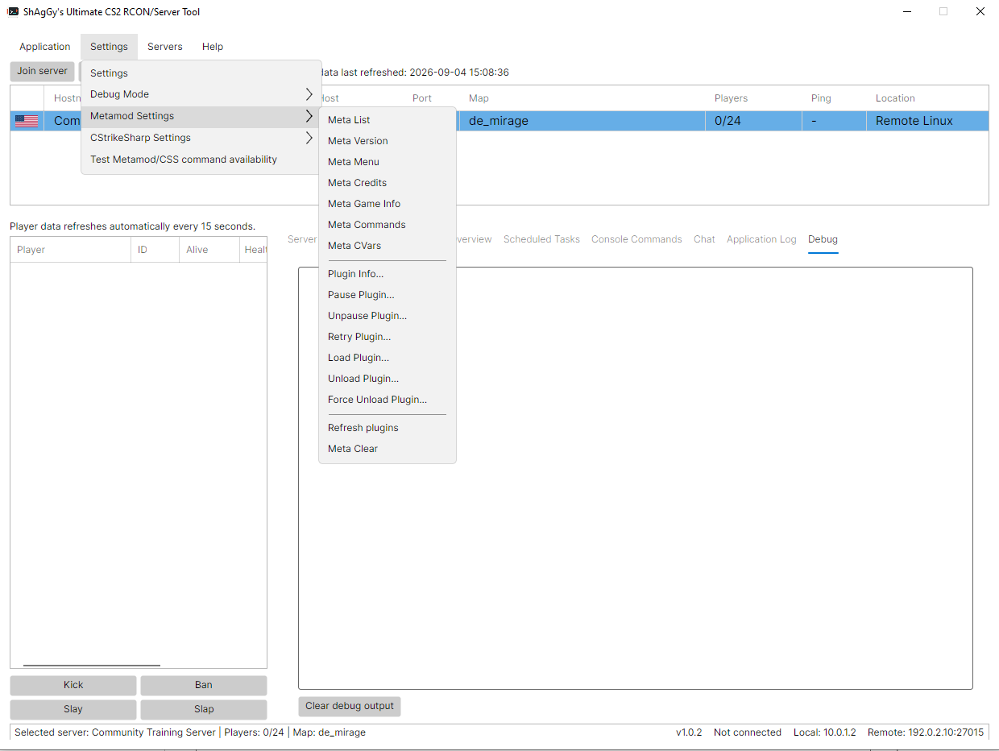
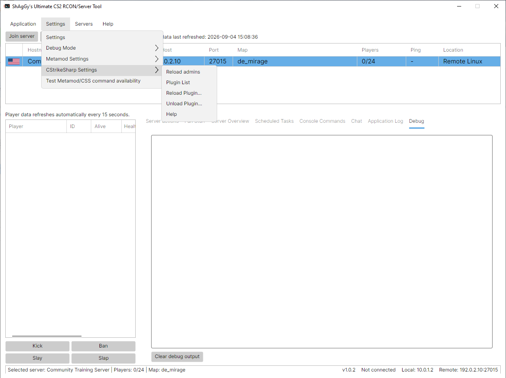

# Ultimate CS2 RCON and Server Management Tool

Version: 1.0.5

Developer: ShAgGy

ShAgGy's Ultimate CS2 RCON and Server Management Tool is a cross-platform desktop application for administering Counter-Strike 2 dedicated servers. It provides RCON commands, local and remote lifecycle management, SteamCMD maintenance, add-on installation, scheduling, backups, player monitoring, and authenticated chat integration from one shared Avalonia application.

## Issues

Report application issues at https://github.com/ShAgGy2035/Ultimate-RCON-Server-Tool/issues/new.

## Table of Contents

- [Choose Your Platform](#choose-your-platform)
- [Release Packages](#release-packages)
- [Features](#features)
- [Quick Start](#quick-start)
- [Lifecycle Modes](#lifecycle-modes)
- [Remote Linux Hosting Panel](#remote-linux-hosting-panel)
- [Server Installation And Updates](#server-installation-and-updates)
- [Main Areas](#main-areas)
- [PlayerPunishments](#playerpunishments)
- [Settings](#settings)
- [Frameworks And Plugins](#frameworks-and-plugins)
	- [Install Frameworks And Plugins](#install-frameworks-and-plugins)
- [Backups And Restore](#backups-and-restore)
- [Data Storage And Security](#data-storage-and-security)
- [Updating Or Migrating Data](#updating-or-migrating-data)
- [Troubleshooting](#troubleshooting)
- [About](#about)
- [Application Screenshots](#application-screenshots)

## Choose Your Platform

The root README is the project overview. The platform guides are the complete start-to-finish procedures for preparing the host, configuring a profile, installing or updating CS2, and starting the server.

| Application package | Guide | Local CS2 hosting | Remote targets |
| --- | --- | --- | --- |
| Windows x64 | [Windows guide](README-WINDOWS.md) | Local Windows | Linux and Windows |
| Linux x64 | [Linux guide](README-LINUX.md) | Local Linux | Linux and Windows |
| macOS Intel or Apple Silicon | [macOS guide](README-MACOS.md) | Not supported by Valve | Linux and Windows |

macOS 12.0 or later is required. Remote Linux and Remote Windows management use SSH/SFTP; Remote Windows does not require WinRM or a separate SFTP server. Before configuring a Remote Windows profile, prepare OpenSSH and the remote Windows account using the [Remote Windows SSH setup](README-WINDOWS.md#create-the-windows-ssh-user) instructions.

## Release Packages

- `cs2-rcon-tool-universal-v1.0.5-windows-x64.zip`
- `cs2-rcon-tool-universal-v1.0.5-linux-x64.tar.gz`
- `cs2-rcon-tool-universal-v1.0.5-macos-x64.tar.gz`
- `cs2-rcon-tool-universal-v1.0.5-macos-arm64.tar.gz`
- `cs2-rcon-tool-universal-v1.0.5-macos-x64.zip`
- `cs2-rcon-tool-universal-v1.0.5-macos-arm64.zip`
- `cs2-rcon-tool-universal-v1.0.5-all-platforms.zip`

The macOS tarballs preserve executable permissions. The v1.0.5 release also includes ZIP alternatives; future macOS releases will provide tarballs only. The all-platforms v1.0.5 bundle includes all six platform archives.

Each platform build contains a self-contained, single-file native application. A separate .NET installation is not required. GeoLite data and flag images remain external runtime assets by design.

## Features

- Query CS2 server information and connected players.
- Run categorized RCON commands with suggestions and autocomplete.
- Start, stop, restart, install, update, and validate supported servers.
- Manage local servers on Windows and Linux.
- Manage remote Linux and Windows servers over SSH.
- Choose Direct process or Service commands lifecycle ownership.
- Configure startup maps, Workshop content, CFG, player passwords, tickrate, VAC, and LAN mode.
- Install or upgrade Metamod, CounterStrikeSharp, and tracked optional plugins.
- Apply Fun Stuff modes with exact per-server rollback.
- Back up and restore server files and MySQL/MariaDB databases.
- Schedule RCON and maintenance operations using built-in or native schedulers.
- Receive authenticated game chat from the separate ChatRelay plugin over UDP.
- Maintain GeoLite country information and a 195-country flag set.

## Quick Start

1. Download and extract the package for your operating system.
2. Follow the matching [Windows](README-WINDOWS.md), [Linux](README-LINUX.md), or [macOS](README-MACOS.md) launch instructions.
3. Open **Servers > Manage servers**.
4. Add a server and enter its name, host/IP, game/RCON port, RCON password, and location.
5. Complete lifecycle and SteamCMD settings when the application will manage those operations.
6. Save the profile, select it in the top server list, and click **Refresh server list**.
7. Right-click the server and select **Install/Update server...**, or **Install/Update Server + Add-ons** when framework and tracked-plugin maintenance is also required. Wait for the operation to finish, review **Console Commands**, **Application Log**, or **Debug**, then right-click the server again and select **Start server**. Normal Start validates the server before launching when SteamCMD is configured.

If you chose **Install/Update server...** without add-ons, right-click the running server and select **Install/Upgrade Metamod**, then **Install/Upgrade CSS**, then **Install/Upgrade CSS Plugins...**. Paste the requested package or plugin repository/release URLs, wait for each operation to finish, and restart the server after framework/plugin installation.

Paste each of these URLs into the **Install/Upgrade CSS Plugins...** window one at a time:

```text
https://github.com/ShAgGy2035/RconCompanionTool
https://github.com/ShAgGy2035/ChatRelay
https://github.com/ShAgGy2035/PlayerPunishments
```

RCON uses TCP. The configured RCON port must be reachable from the computer running the application; opening only the UDP game port is not sufficient.

## Lifecycle Modes

Every supported local or remote profile separates two ownership models:

- **Direct process**: the application builds the launch arguments and owns the CS2 process. Tickrate, VAC, LAN mode, startup map, CFG, credentials, and related launch settings come from the profile. Direct startup is monitored for 30 seconds before it is reported healthy.
- **Service commands**: an existing systemd service or Windows service wrapper owns CS2. The application executes configured Start, Stop, and Restart commands but does not install the service. Launch arguments belong in the service configuration.

Stop the current owner before switching modes. Direct process and Service commands must never manage the same executable and port simultaneously.

Local service Start restores an installed Metamod loader entry after SteamCMD validation before starting the service. If `meta` and CSS commands are unknown after validation, Stop and then Start through Universal; the saved service Restart command alone does not repair loader configuration.

Run Universal unelevated. Service creation and authorization belong to the one-time administrator-managed service setup; Universal neither requests elevation nor modifies service permissions. For Local Windows, see [service control without elevation](README-WINDOWS.md#service-control-without-elevation). Direct process is the alternative when you do not want service setup and your account owns the installation.

Add server provisioning can reuse existing files: it stops the target through the configured lifecycle before installation changes, verifies availability, and starts the newly created profile only when start-after-install is selected and all provisioning stages succeed. Stop failures block provisioning; installation failures leave the target stopped. Local Direct-process discovery uses the install directory even before SteamCMD is configured.

Windows services require a complete WinSW XML and Steamworks runtime DLLs beside `cs2.exe`; a LocalSystem service cannot rely on the signed-in user's Steam installation. See [Local WinSW setup](README-WINDOWS.md#create-a-local-windows-service-with-winsw), [Remote WinSW setup](README-WINDOWS.md#remote-windows-service-commands-with-winsw), and [Steamworks runtime preparation](README-WINDOWS.md#steamworks-runtime-for-windows-services). Automatic service startup at Windows boot runs without Universal and does not invoke the app's SteamCMD validation. Service registration or a brief Running status alone does not prove that CS2 remains running.

Detailed setup:

- [Local and Remote Windows lifecycle](README-WINDOWS.md)
- [Local and Remote Linux lifecycle](README-LINUX.md)
- [Remote management from macOS](README-MACOS.md)

Next: open the guide for the application platform you are using and follow its matching Local or Remote configuration path.

## Remote Linux Hosting Panel

Users whose provider exposes a Pterodactyl-compatible panel but no SSH can manage a hosted Linux server with **Hosting panel API**. Select **Remote Linux**, choose that startup mode, and configure:

- Panel URL, using the panel root such as `https://panel.example.com`.
- The panel server identifier or UUID.
- A client API key with power-control permission.
- SFTP address, username, password, and port for plugin deployment, browsing, and file operations.

Start, Stop, and Restart use the panel API and wait for the panel to report `offline` or `running`. SteamCMD validation and remote shell commands are unavailable in this mode. Debug Mode records panel requests, state polling, and failures without logging the API key.

## Server Installation And Updates

Right-click a configured server and select **Install/Update server...**.

- Local Windows can download and run Windows SteamCMD.
- Local Linux can check prerequisites and download Linux SteamCMD.
- Remote Linux and Remote Windows run configured SteamCMD operations over SSH.
- Use App ID `730`.

SteamCMD runs through the application, and its progress and output are captured in **Console Commands**, **Application Log**, and **Debug** so installation and validation can be monitored without a separate interactive terminal.

On Linux, the first local SteamCMD operation may show an administrator authorization dialog while the application installs required 32-bit runtime prerequisites. This is expected Linux prerequisite setup. See the [Linux SteamCMD prerequisites](README-LINUX.md#steamcmd-linux-prerequisites) section for the package details before cancelling the prompt.

Normal **Start server** validates before startup when the profile has SteamCMD and install-directory settings, including Direct process and Service commands profiles. **Validate server files** validates without starting the server, while **Install/Update Server** updates, repairs, and validates the CS2 installation. Ordinary Restart skips validation. Use **Start server without validation** from the server table's right-click menu for troubleshooting when you need to start without waiting for SteamCMD validation.

When a managed local CS2 process is running, the application pauses before SteamCMD and offers to stop the server and continue. Cancelling leaves the server running and aborts the update or validation. After SteamCMD restores core files, **Install/Update Server** reapplies and validates the Metamod/CounterStrikeSharp loader chain before reporting success.

**Install/Update Server + Add-ons** combines a server update with supported framework and tracked-plugin maintenance.

Next: [Main Areas](#main-areas) for server actions, integrations, scheduling, and plugin management.

## Main Areas

### Server List And Actions

The top list displays hostname, address, port, map, players, ping, location, and country. Its context menu provides lifecycle, installation, add-on, backup, restore, validation, copy, and edit operations.

Click **Add server** in the top toolbar to open the location-aware setup wizard. It offers only startup methods supported by the selected location, validates the host, port, and RCON password, and lets you enable LAN mode (`sv_lan 1`). Steam API keys and GSLTs are optional. For install actions, the wizard collects the required local/remote CS2 install folder and remote SSH credentials; SteamCMD is installed or discovered automatically. At the end, choose to finish setup, install/update CS2, or install/update CS2 with Metamod and CounterStrikeSharp, and optionally start the server when installation succeeds. Hosting panel API profiles ask who manages frameworks; provider-managed CS2 core updates stay in the panel, while Application-managed installs frameworks through the app. After framework installation, the app offers its existing Metamod and CSS plugin selectors. Optional launch arguments, Workshop maps, integrations, and other advanced settings can be changed later from **Manage servers > Edit server**. **Help > Sample server profile** opens a complete, read-only example; it is not added to the server list.

Server Actions control hostname, bots, teams, passwords, friendly fire, cheats, pause, map changes, maximum rounds, timed restarts, and player punishments. These controls send runtime commands and do not edit server CFG files. Configure the Startup CFG and player connection password in the server profile.

The map selector lists playable maps and configured Workshop maps.

Deleting a server requires confirmation. Optional app-state cleanup removes that profile's scheduled tasks, external scheduler entries, console history, and cached state. It does not delete CS2 installations, plugins, backups, or files from the managed server.

### Joining A Server

Select a server and click **Join server**. Windows uses the registered Steam URI handler, Linux tries Steam and desktop URI handlers, and macOS uses `open`. If CS2 opens without connecting, paste the copied `connect IP:port` command into the CS2 developer console.

### Fun Stuff

Use **Main Areas > Fun Stuff** to apply a game mode to the selected server. Available modes are **No Bots**, **Bot Control**, **AWP / Sniper Wars**, **Bhop**, **Deathmatch**, **Grenade Wars**, **Headshot Only**, **Knife Arena**, **Molotov / Incendiary Wars**, **One in the Chamber**, **Pistols Only**, **ScoutzKnives**, **Super Hero**, **Surf**, and **Zeus Wars**. Each mode has its own options and apply/rollback behavior; its settings are not shared with other modes.

#### Apply, switch, and roll back

Before applying a mode, Universal records the server's affected settings. Switching modes first restores the active mode, then applies the selected mode. Choose **None (rollback)** to restore the captured settings; this does not edit server CFG files.

Mode switches generally restart the round. **No Bots** rollback restores the captured quota without restarting it. Deathmatch requires a map reload when leaving it, and **One in the Chamber** reloads the current map when it starts or rolls back. Modes are reapplied after map changes: keep Universal open for modes started from the app, while Companion handles map reapply for modes started with `!fun` or a scheduled rotation.

By default, Companion rolls back the active mode when the last human leaves. The **Empty-server rollback (server-wide)** panel shows and updates the selected server's policy without starting or replacing a mode. Its grace period defaults to five minutes; a returning human cancels a pending automatic rollback. Explicit rollback takes effect immediately.

#### Bot controls

**Bot Control** changes bot enablement, quota, quota mode, and team without replacing the active mode. A blank enabled quota leaves the current quota unchanged; setting a quota enforces it. The `fill` quota mode maintains the configured total as humans join; `normal` and `match` are also available. You can assign bots to CT or T for uneven training, or choose **Any** to restore normal team assignment.

**No Bots** sets `bot_quota` to zero and kicks current bots. Rolling it back restores the captured quota. The in-game `!fun` menu also provides bot controls for each mode. Changes made in its Bot Control panel are staged until **Apply now**, which saves the preferences to `RCT.json` and applies them to the server.

#### Mode-specific options

- **One in the Chamber** uses individual Deathmatch scoring, random spawns, a Deagle, a knife, and one starting bullet. A non-self kill grants another bullet; a miss requires a knife kill to recover ammo. Deagle body damage can be disabled with **Deagle headshots only**; knife hits remain lethal. Buying and C4 objectives are disabled.
- **Super Hero** keeps normal weapons and buying. Each player receives one enabled power on spawn: Speedster, Moon Jumper, Tank, Ghost, Vampire, Regenerator, Juggernaut, Second Wind, Ammo Recycler, Berserker, Medic, Blink, Double Jump, or Gunslinger. The Options panel exposes all fourteen powers and their strength settings. Powers are distributed among teammates before repeats when possible. The assigned power is shown in a center-screen notice; **Power popup (seconds)** sets its duration from 0 to 30, where 0 disables it.
- **ScoutzKnives** offers controls for air acceleration, gravity, fall-damage scale, friction, and bunnyhopping. **Surf** offers movement, stamina, round-time, freeze-time, and cheats settings. These values can also be configured in `RCT.json`.
- Loadout modes manage their own weapon rules. AWP / Sniper Wars, Pistols Only, Knife Arena, Zeus Wars, Grenade Wars, and Molotov / Incendiary Wars each apply their corresponding loadout. Headshot Only changes damage rules without changing buying, buy zones, loadouts, or dropped weapons.

#### Companion setup

Fun Stuff modes require the current [RCON Tool Companion 1.0.2 build](https://github.com/ShAgGy2035/RconCompanionTool), built against CounterStrikeSharp API 1.0.376. Companion includes the in-game menu, so no separate menu plugin is needed. Administrators with `@css/fun` can open it with `!fun` or `/fun`; use **W/S** to move, **E** to select, **A** to go back, and **R** to exit. In-game administrators can configure bot settings from each mode's submenu.

Companion stores mode settings in `configs/plugins/RCT/RCT.json`. Upgrading Companion does not add new options to an existing file; missing options use their defaults. See the Companion README's **Upgrading an existing `RCT.json`** section to add options manually or regenerate the file.

### Scheduled Tasks

Task types include RCON commands, framework/plugin maintenance, server backups, database backups, and GeoLite/flag updates. Triggers include Day, Hour, and Startup. The built-in scheduler runs while the application is open and monitoring is active. Native external tasks invoke the headless task runner and do not require the GUI to remain open; they use Windows Task Scheduler, systemd user timers, or launchd user agents.

**Fun Stuff rotation** tasks start one or more Fun Stuff modes in order. Each step has a mode and a duration in minutes; after the last step the rotation can stay on the last mode, roll it back, or repeat from the first step. A single step with **Stay on last mode** simply switches the server into that mode at the trigger time. Modes are started by RCON Tool Companion 1.0.2 using its `RCT.json` settings (also editable in game through `!fun`). Rotations run only in the built-in scheduler while the app is open; editing or deleting the task, or stopping the scheduler, ends a running rotation and leaves the current mode active.

### Console, Logs, And Chat

Console Commands accepts free-form RCON commands and provides categorized suggestions. Each server has separate bounded history. Application Log reports normal operations and failures; Debug provides detailed diagnostics. Passwords, credentials, API keys, and tokens are redacted from console history, logs, and debug output. When closing with Debug Mode enabled, choose **Stop debugging** to disable it and return to the app or **Exit program** to close anyway.

The Chat tab receives authenticated JSON messages from the separate [ChatRelay](https://github.com/ShAgGy2035/ChatRelay) CounterStrikeSharp plugin over UDP and can send admin chat through RCON. Configure the receiving adapter and port, set a unique token under **Edit server > Integrations**, then use **Copy ChatRelay target JSON**. The listener accepts authenticated JSON only, limits datagrams to 8 KiB, and drops rejected packets. Restrict firewall access to the game server or trusted LAN, or use a VPN.

## PlayerPunishments

The Slay and Slap controls send `css_slay #userid` and `css_slap #userid damage`. Install [PlayerPunishments 1.0.0 or newer](https://github.com/ShAgGy2035/PlayerPunishments) when the server's existing administration package does not provide those commands. The player table's Alive and Health values also depend on the required server-side player-information command and display **Unknown** when it is unavailable.

Configure Slap damage from `0` to `99` under **Settings > General**. PlayerPunishments is installed on the managed CS2 server as a CounterStrikeSharp plugin, not beside the desktop application.

## Settings

Open **Settings > Settings** for application-wide options. The **General** tab includes GeoLite and country-flag URLs, slap damage, automatic 15-second server-list refresh, noisy-output filtering, and GeoLite/flag updates. The **Backups** tab provides separate destinations for server-file and database backups.

Server-specific lifecycle, SteamCMD, map, RCON, player-password, database, ChatRelay, Steam authentication, and backup credentials remain under **Servers > Manage servers > Edit server**.

## Frameworks And Plugins

### Install Frameworks And Plugins

Install Metamod before CounterStrikeSharp. Interactive installation shows the latest 20 compatible releases and accepts a selected release or direct HTTP(S) package URL. Scheduled and headless maintenance use the newest compatible releases because they cannot display selection dialogs.

1. Select the configured server in the top server list.
2. Right-click the server and select **Install/Upgrade Metamod**. Choose a compatible release or paste the direct package URL when prompted, then wait for installation to finish.
3. Right-click the server again and select **Install/Upgrade CSS**. Choose a compatible release or paste the direct package URL when prompted, then wait for installation to finish.
4. Right-click the server again and select **Install/Upgrade CSS Plugins...** to install optional CounterStrikeSharp plugins. Paste the plugin's GitHub or supported GitLab repository/release URL, choose the matching release asset if prompted, and wait for deployment to finish.
5. Restart the server after installing or upgrading frameworks or plugins so the server loads them.

Under **Settings > Metamod Settings**, list plugins and run info, pause, unpause, retry, load, unload, or force-unload operations. Under **Settings > CStrikeSharp Settings**, reload admins and list, reload, or unload plugins. Use **Settings > Test Metamod/CSS command availability** to probe safe command forms with nonexistent plugin IDs without targeting real plugins.

Optional plugins can come from GitHub, a public GitLab.com project including nested groups, or a supported local archive or library. The installer filters assets by server OS. When a release has multiple packages for that OS, the application asks which asset to install and remembers a version-independent filename preference for later upgrades. Installed files are tracked per server in:

```text
game/csgo/.cs2-rcon-tool-plugins.json
```

Use the **Manage Metamod plugins** window only for packages containing an `addons/metamod` payload. Use the **Manage CounterStrikeSharp plugins** window for CounterStrikeSharp plugin packages. The application rejects packages submitted through the wrong manager before deployment.

Keep this ownership manifest with the server. It allows uninstall to remove owned files while preserving shared files, configuration, and framework files.

Remote framework and plugin updates replace native binaries instead of truncating loaded files in place. A running server continues using the previous binary until restart, avoiding memory-mapped library crashes during deployment.

## Backups And Restore

- **Backup server** archives configuration, add-ons, maps, `gameinfo.gi`, and plugin tracking instead of stock CS2 binaries or Workshop downloads.
- **Backup database** runs `mysqldump` using the selected server's integration settings.
- **Restore server backup...** validates and restores ZIP, TAR.GZ, or TGZ content, stopping and restarting the server as needed.
- **Install/update + restore server backup...** updates core files before restoring a backup.
- **Restore database backup...** imports SQL using the configured MySQL client.

Remote operations require appropriate SSH permissions and archive tools on the managed host.

## Data Storage And Security

Writable data is stored per user, not beside the executable:

- Windows: `%APPDATA%\CS2RconTool`
- Linux: typically `~/.config/CS2RconTool`
- macOS: typically `~/Library/Application Support/CS2RconTool`

The directory contains:

- `servers.json`: profiles and protected credentials.
- `tasks.json`: scheduled tasks and protected credentials.
- `steam_settings.json`: application settings and protected tokens.
- `fun_stuff_state.json`: per-server Fun Stuff state without credentials.
- `app_state.json`: settings schema, last validated app version, and validation time.
- `migration-backups/`: invalid settings files moved aside during startup recovery.
- `credential.key`: the per-user AES key.
- `GeoLite2-Country.mmdb` and `flags/`: writable GeoIP assets.

Saved secrets use AES-256-GCM. Protect `credential.key` as carefully as the JSON files. Release archives intentionally exclude settings, keys, caches, PDB files, ChatRelay binaries, and Companion binaries.

## Updating Or Migrating Data

Close the application before updating. Replace application files or extract the new package to a new folder; on macOS, replace the entire app bundle. Back up the complete per-user `CS2RconTool` directory first.

For migration:

1. Open the new application once, then close it.
2. Back up its generated per-user data directory.
3. Copy `servers.json`, `tasks.json`, `steam_settings.json`, and `fun_stuff_state.json` from the old installation.
4. Copy the matching old `credential.key` when available.
5. Reopen the application.

Configuration can load when protected credentials cannot be decrypted, but affected RCON, SSH, database, ChatRelay, Steam API, and GSLT values must be re-entered and saved.

Remote profiles remain portable when valid credentials and target paths are supplied. New profiles default to the local type supported by the current OS. Existing imported profile locations are not changed automatically, and an incompatible local profile must be changed to a supported location before it can be saved.

Hosting providers with a Pterodactyl-compatible panel but no SSH can use **Hosting panel API** for Remote Linux lifecycle control. Configure the panel URL, server identifier/UUID, and encrypted client API key, then keep SFTP credentials for plugin deployment, browsing, and file operations. This mode uses the panel API for Start, Stop, and Restart and does not attempt SteamCMD validation or remote shell commands. Debug Mode records panel requests and state polling without logging the API key.

For hosted profiles, set **Framework management** to **Host-managed** when the provider preloader owns Metamod and CounterStrikeSharp. In Host-managed mode, the app blocks framework installation and upgrades but continues to support optional CounterStrikeSharp plugin deployment over SFTP. Use **Application-managed** only when the server provider does not manage those frameworks.

- When moving to Windows, change `Local Linux` to `Local Windows`, then replace the Linux executable, SteamCMD, install-directory, working-directory, and launch paths with Windows paths.
- When moving to Linux, change `Local Windows` to `Local Linux`, then replace the Windows executable, SteamCMD, install-directory, working-directory, and launch paths with Linux paths.
- macOS cannot run local CS2 profiles. Convert an imported local profile to the correct Remote Linux or Remote Windows type and provide valid target paths and credentials.

## Troubleshooting

### RCON commands fail

- Re-enter and save the RCON password, especially after migration.
- Verify host/IP and TCP port.
- Confirm the server's `rcon_password` matches the profile.
- Confirm firewalls permit the RCON TCP connection.
- Use Application Log and Debug for connection details.

### A Linux server in a bridged VirtualBox VM is unreachable

- Set the app's server host/IP to the Linux guest VM's bridged LAN address, not the Windows host's address or `127.0.0.1`.
- Ensure the VM's `/etc/hosts` maps `127.0.1.1` to the VM hostname.
- Add `-ip 0.0.0.0` to Direct-process launch arguments so CS2 listens on every interface; put the chosen `-ip` value in the service unit for Service commands mode.
- Confirm the VirtualBox adapter is in Bridged Adapter mode. If a Host-Only adapter such as `Ethernet 2` interferes with routing, disable it while keeping the physical Ethernet/Wi-Fi adapter enabled.
- Confirm guest and host firewalls permit the configured game and RCON ports.

### Local server exits immediately

- Check Application Log and Debug for the exit code and stderr.
- Verify the executable, working directory, and launch arguments.
- Confirm the local profile type matches the current OS.
- On Linux, verify required runtime libraries and Steam client files.

### Remote lifecycle, browsing, or installation fails

- Verify SSH host, port, username, and password.
- Re-enter the SSH password after migration if necessary.
- Confirm the account can run lifecycle commands and write to the install directory.
- Confirm the target has the archive tools required by the operation.

### Metamod or CounterStrikeSharp commands are unknown

- Install or validate Metamod before CounterStrikeSharp.
- Confirm `gameinfo.gi` contains the Metamod search path.
- Restart CS2 after framework installation or repair.
- Run `meta list` and `css_plugins list` from Console Commands.
- Use the built-in command-availability test.

### Join Server opens CS2 but does not connect

- Open the CS2 developer console with `~`.
- Paste the copied `connect IP:port` command and press Enter.
- Enable the developer console in CS2 settings if needed.

### Chat does not appear

- Verify ChatRelay is installed and running separately.
- Verify destination IP, adapter, UDP port, and token on both sides.
- Re-enter the token after migration if necessary.
- Check firewall rules and use the Chat tab's **Test** action.

### Scheduled tasks do not run

- Confirm the task is active and its trigger/time is valid.
- Start monitoring for built-in tasks and keep the app open.
- For native tasks, inspect Task Scheduler, the user systemd timer, or LaunchAgent.
- Confirm the selected profile and credentials are valid.

### Country or flag data is missing

- Select **Settings > General > Update GeoLite + flags**.
- Confirm the configured URLs are direct-download sources.
- Confirm the per-user data directory is writable.

Platform-specific diagnostics:

- [Windows troubleshooting](README-WINDOWS.md#troubleshooting)
- [Linux troubleshooting](README-LINUX.md#troubleshooting)
- [macOS troubleshooting](README-MACOS.md#troubleshooting)

## About

Open **Help > About** to view the application version, developer information, and detected platform. Use **Help > Check for Updates** to check on demand; startup checks are enabled by default and can be disabled in Settings. A newer GitHub release is reported with a link, and the app never downloads or installs it. The opt-in **Minimize to tray** setting keeps the app running when minimized or closed, when the desktop provides tray-menu support.

Hiding to a supported tray shows a brief **Still running in the tray** reminder with **Show** and **Exit** actions, and updates the tray tooltip. The reminder dismisses after eight seconds without taking keyboard focus. **Show** restores the main window; **Exit** requests normal application shutdown. Actual OS tray interaction still needs platform testing; headless rendering/actions and display-position checks passed.

GUI launches are single-instance per user/settings directory. Launching the shortcut again asks the existing process to restore its main window, including when hidden in the tray, rather than starting another GUI. Activation requests during startup are queued until the window opens. Headless scheduled tasks (`--run-task`) and asset updates (`--update-geo-assets`) remain independent. Close older running builds through the tray's **Exit** before upgrading; they do not participate in the new activation protocol. Separate-process lock/activation tests passed; live desktop restoration across platforms still needs testing.

Console feedback distinguishes successful submission from confirmed execution. Known silent commands such as `css_plugins reload 9` say **No response text is expected for this operation** when their reply is empty. Other empty replies explicitly leave server-side success unconfirmed; failed sends are not labelled as sent. Actual response/error text is displayed unchanged.

## Application Screenshots

| Server actions | Server context menu |
| --- | --- |
|  |  |
| Manage servers | Edit a Remote Linux server |
|  |  |
| Edit server integrations | Add scheduled task |
|  |  |
| Fun Stuff modes | Server overview |
|  |  |
| Scheduled tasks | Console commands |
|  |  |
| Chat | Application log |
|  |  |
| Debug output | General settings |
|  |  |
| Settings menu | Backup settings |
|  |  |
| Metamod controls | CounterStrikeSharp controls |
|  |  |